# BAH Atlas — Work Breakdown Structure

<!-- GENERATED FILE. Edit docs/wbs/nodes.csv or docs/wbs/milestones.csv, then run `make wbs`. -->

**Status as of:** 24 October 2026  
**Nodes tracked:** 74  ·  ⚫ Complete (before this week): 25  ·  🟢 Completed this week: 20  ·  🟣 In progress: 1  ·  🔴 Not started: 25  ·  ⚪ Scrapped: 3

This page is the live project tracker. It is regenerated from [`docs/wbs/nodes.csv`](wbs/nodes.csv) every time progress changes, so the commit history of that file is the project's change log. Narrative updates (what was done, what is next, setbacks and changes) are in the [weekly progress log](#weekly-progress-log).

## Milestones

Progress counts **required** nodes only; optional and scrapped nodes are tracked but do not gate a milestone.

| Milestone | Due | Required complete | Progress | Status |
|---|---|---|---|---|
| **M1** Layer 1 Sources + 2.1 Ingest Outputs | Sat 26 Sep | 15 / 15 | `██████████ 100%` | ✅ Complete |
| **M2** 2.2 Geometry | Sat 03 Oct | 2 / 2 | `██████████ 100%` | ✅ Complete |
| **M3** 2.3 MHA Benchmarks + 2.4 Ownership Metrics | Sat 10 Oct | 4 / 4 | `██████████ 100%` | ✅ Complete |
| **M4** 2.5 Computed Metrics | Sat 17 Oct | 4 / 4 | `██████████ 100%` | ✅ Complete |
| **M5** 2.6 Spatial Statistics | Sat 24 Oct | 3 / 3 | `██████████ 100%` | ✅ Complete |
| **M6** 2.7 Front-End Payload + 2.8 Writeup | Fri 30 Oct | 13 / 14 | `█████████░ 93%` | ⏳ Due in 6 days |
| **M7** Layer 3 Front-End | Mon 16 Nov | 0 / 20 | `░░░░░░░░░░ 0%` | 🗓️ Upcoming |

## In progress now

- 🟣 **W1** Layer 2 writeup (how Layer 1 becomes Layer 3) — due 30 Oct (M6)

## Nodal map

Colour key: ⚫ Complete (before this week)  ·  🟢 Completed this week  ·  🟣 In progress  ·  🔴 Not started  ·  ⚪ Scrapped  ·  dashed border = optional node. Scrapped nodes stay listed so their ids and history are kept. Arrows point from an input to the node built from it.

```mermaid
flowchart LR
    subgraph L1["Layer 1 — Authoritative Sources"]
        direction TB
        subgraph S1["1 Sources and Config"]
            A1["A1 DTMO BAH ASCII release"]
            A2["A2 Census 2020 ZCTA cartographic boundaries"]
            A3["A3 Zillow ZORI"]
            A4["A4 Zillow ZHVI"]
            A5["A5 HUD FMR / SAFMR FY2026"]
            A6["A6 DoD BAH Rate Component Breakdown"]
            A7["A7 Mortgage rate reference"]
            A8["A8 Property tax and insurance reference"]
            A9["A9 Census ACS context"]
            A10["A10 BEA Regional Price Parities"]
            A11["A11 Protomaps basemap source"]
            A12["A12 Profile definitions config"]
            A13["A13 Classification and color scheme config"]
            A14["A14 DoD BAH housing standards by grade and dependency status"]
            A15["A15 Zillow ZORI by home type"]
            A16["A16 Zillow ZHVI by home type and bedroom count ZIP-level"]
        end
    end
    subgraph L2["Layer 2 — Data Processing"]
        direction TB
        subgraph S2_1["2.1 Ingest Outputs"]
            B1["B1 zip_mha.csv"]
            B2["B2 zip_mha_geo.csv"]
            B3["B3 mha_names.csv"]
            B4["B4 bah_rates.csv"]
            B5["B5 rate_components.csv"]
        end
        subgraph S2_2["2.2 Geometry"]
            B6["B6 MHA polygons"]
            B7["B7 MHA PMTiles"]
        end
        subgraph S2_3["2.3 MHA Benchmarks"]
            B8["B8 ZORI at MHA"]
            B9["B9 ZHVI at MHA"]
            B10["B10 FMR at MHA"]
            B29["B29 Rent benchmark by home type at MHA"]
        end
        subgraph S2_4["2.4 Ownership Metrics"]
            B11["B11 Ownership monthly cost at MHA"]
            B30["B30 Ownership cost by home type at MHA"]
        end
        subgraph S2_5["2.5 Computed Metrics"]
            B12["B12 Rent coverage ratio"]
            B13["B13 Rent surplus/gap"]
            B14["B14 Buy coverage ratio"]
            B15["B15 Buy surplus/gap"]
        end
        subgraph S2_6["2.6 Spatial Statistics"]
            B16["B16 Spatial weights matrix"]
            B17["B17 Global Moran's I"]
            B18["B18 LISA / Getis-Ord Gi* clusters"]
            B19["B19 Spatial regression"]
        end
        subgraph S2_7["2.7 Front-End Payload"]
            B20["B20 Attribute payload JSON"]
            B21["B21 UI metadata JSON"]
            B22["B22 Build manifest JSON"]
            B28["B28 CCG and territory polygons"]
            B31["B31 Grid payload"]
            W2["W2 Data contract"]
        end
        subgraph S2_8["2.8 Writeup, QA and Enrichments"]
            B23["B23 QA / validation report"]
            B24["B24 ACS context join"]
            B25["B25 BEA RPP context join"]
            B26["B26 H3 hex overlay"]
            B27["B27 Hotspot overlay payload"]
            W1["W1 Layer 2 writeup"]
        end
    end
    subgraph L3["Layer 3 — Front-End"]
        direction TB
        subgraph S3_1["3.1 Served Artifacts"]
            C1["C1 MHA PMTiles"]
            C2["C2 Attribute payload JSON"]
            C3["C3 UI metadata JSON"]
            C4["C4 Basemap PMTiles"]
        end
        subgraph S3_2["3.2 Map and UI Runtime"]
            C5["C5 App bootstrap + MapLibre init"]
            C6["C6 UI state object"]
            C7["C7 Control panel"]
            C8["C8 Feature-state join"]
            C9["C9 Choropleth paint expression"]
            C10["C10 Legend"]
            C11["C11 MHA detail popup/panel"]
            C12["C12 A/B comparison panel"]
            C13["C13 Rent/Buy toggle"]
            C14["C14 Render function"]
            C15["C15 ZIP search to highlight MHA"]
            C16["C16 Hotspot overlay toggle"]
            C17["C17 Shareable URL / permalink"]
            C18["C18 Utilities toggle"]
            C19["C19 Data export"]
            C20["C20 Attribution + methodology"]
            C21["C21 About / data-caveats page"]
            C25["C25 Authorized-standard notice"]
        end
        subgraph S3_3["3.3 Build and Delivery"]
            C22["C22 Build bundler"]
            C23["C23 CI/CD"]
            C24["C24 CDN hosting + security headers"]
        end
    end
    A1 --> B1
    A1 --> B2
    A1 --> B3
    A1 --> B4
    A6 --> B5
    A2 --> B6
    B1 --> B6
    B6 --> B7
    B28 --> B7
    A3 --> B8
    B1 --> B8
    B5 --> B8
    A4 --> B9
    B1 --> B9
    A5 --> B10
    B1 --> B10
    A7 --> B11
    A8 --> B11
    B8 --> B11
    B9 --> B11
    A12 --> B12
    A14 --> B12
    B4 --> B12
    B29 --> B12
    B10 --> B12
    A12 --> B13
    A14 --> B13
    B4 --> B13
    B29 --> B13
    B10 --> B13
    A12 --> B14
    A14 --> B14
    B4 --> B14
    B30 --> B14
    A12 --> B15
    A14 --> B15
    B4 --> B15
    B30 --> B15
    B6 --> B16
    B12 --> B17
    B16 --> B17
    B12 --> B18
    B16 --> B18
    B12 --> B19
    B16 --> B19
    B8 --> B19
    A3 --> B19
    B24 --> B19
    B12 --> B20
    B13 --> B20
    B14 --> B20
    B15 --> B20
    B3 --> B20
    B4 --> B20
    A12 --> B20
    B28 --> B20
    B22 --> B20
    A12 --> B21
    A13 --> B21
    B1 --> B21
    B3 --> B21
    B28 --> B21
    B22 --> B21
    B7 --> B22
    B28 --> B22
    A2 --> B28
    B1 --> B28
    B20 --> B23
    B22 --> B23
    A9 --> B24
    A2 --> B24
    B1 --> B24
    A10 --> B25
    B1 --> B25
    B6 --> B26
    B18 --> B27
    B22 --> B27
    A15 --> B29
    B8 --> B29
    B10 --> B29
    B1 --> B29
    A16 --> B30
    B9 --> B30
    B11 --> B30
    A14 --> B31
    B4 --> B31
    B29 --> B31
    B30 --> B31
    B22 --> B31
    B23 --> W1
    B7 --> C1
    B20 --> C2
    B21 --> C3
    A11 --> C4
    C1 --> C5
    C2 --> C5
    C3 --> C5
    C4 --> C5
    C7 --> C6
    C13 --> C6
    C14 --> C8
    C2 --> C8
    C14 --> C9
    C3 --> C9
    C14 --> C10
    C14 --> C11
    C14 --> C12
    C6 --> C14
    C2 --> C14
    C3 --> C14
    C3 --> C15
    C6 --> C15
    B27 --> C16
    C6 --> C17
    C6 --> C18
    C2 --> C18
    C6 --> C19
    C2 --> C19
    C3 --> C20
    B23 --> C21
    C22 --> C23
    C23 --> C24
    C6 --> C25
    C3 --> C25
    classDef done fill:#1f1f1f,stroke:#000,color:#ffffff
    classDef week fill:#2e7d32,stroke:#000,color:#ffffff
    classDef prog fill:#7b1fa2,stroke:#000,color:#ffffff
    classDef todo fill:#c62828,stroke:#000,color:#ffffff
    classDef gone fill:#e0e0e0,stroke:#000,color:#616161
    classDef opt stroke-dasharray:5 4,stroke-width:2px,stroke:#9e9e9e
    class A1,A2,A3,A4,A5,A6,A7,A11,A12,A13,B1,B2,B3,B4,B5,B6,B7,B8,B9,B10,B11,B12,B13,B14,B15 done
    class A8,A9,A14,A15,A16,B16,B17,B18,B19,B20,B21,B22,B28,B23,B24,B27,B29,B30,B31,W2 week
    class W1 prog
    class C1,C2,C3,C4,C5,C6,C7,C8,C9,C10,C11,C12,C13,C14,C15,C16,C17,C18,C19,C20,C21,C22,C23,C24,C25 todo
    class A10,B25,B26 gone
    class A9,A10,B19,B24,B25,B26,B27,C15,C16,C17,C18,C19 opt
```

## Master node list

### Layer 1 — Authoritative Sources

External inputs and project-authored config. Deterministic: identical inputs, identical results.

#### Sources and Config — due 26 September 2026 (M1)

| Status | ID | Node | Type | Inputs | Notes |
|:---:|---|---|---|---|---|
| ⚫ | **A1** | DTMO BAH ASCII release (BAH-ASCII-2026.zip) | required | — |  |
| ⚫ | **A2** | Census 2020 ZCTA cartographic boundaries | required | — |  |
| ⚫ | **A3** | Zillow ZORI (rent index) ZIP-level | required | — | completed 03 Oct |
| ⚫ | **A4** | Zillow ZHVI (home value index) ZIP-level | required | — | completed 03 Oct |
| ⚫ | **A5** | HUD FMR / SAFMR FY2026 | required | — | completed 03 Oct |
| ⚫ | **A6** | DoD BAH Rate Component Breakdown | required | — | completed 03 Oct |
| ⚫ | **A7** | Mortgage rate reference (Freddie Mac PMMS) | required | — |  |
| 🟢 | **A8** | Property tax and insurance reference | required | — | Made required 18 Oct 2026: locality property tax and insurance replace the B11 national placeholders, and B11-B18 are rebuilt on them before the M6 payload. Tracked under M6 (milestones.csv) so M1 stays closed. Insurance used as published (2018-2022), understatement documented; code ready 18 Oct: FIO workbook (direct) + `make taxins`; state fallback from FIO itself proposed (D11); D11 decided 18 Oct: insurance state fallback from FIO itself; completed 18 Oct |
| 🟢 | **A9** | Census ACS context | optional | — | Reduced H2 (18 Oct): ZCTA population and land area for urbanicity; shares the Census API client and ZCTA geography with A8; code ready 18 Oct: pinned API query acs5_2024_zcta.json (needs CENSUS_API_KEY), also serves A8 tax; completed 18 Oct |
| ⚪ | **A10** | BEA Regional Price Parities | optional | — | Scrapped 18 Oct 2026 (reduced H2): RPP exists only for states and metro areas, and its rent component repeats the rent-level variable |
| ⚫ | **A11** | Protomaps basemap source (OSM) | required | — | completed 03 Oct |
| ⚫ | **A12** | Profile definitions config | required | — | D18-D19 (18 Oct): research profiles stay e5_dep and o3_dep at their DoD standard; their benchmarks follow D19, so O-3 is recomputed and E-5 does not change; completed 03 Oct |
| ⚫ | **A13** | Classification and color scheme config | required | — | config/ui_text.json (map wording, read only by B21) added 18 Oct (D12); completed 03 Oct |
| 🟢 | **A14** | DoD BAH housing standards by grade and dependency status | required | — | D18 (18 Oct 2026): the DoD housing standard (one of six home types, or the published blend between two) for every pay grade E1-E9, W1-W5, O1-O9 with and without dependents, and each cell's member cost share from the 2026 out-of-pocket table; config/housing_standards.json. Source to settle first: the DoD BAH Primer or the CNA 2026 evaluation (the 2014 summary has no without-dependents or warrant-officer standards); 24 Oct: config/housing_standards.json from the DTMO BAH Primer (Jan 2022; 2018 edition and CNA 2026 Table 1 agree) and the 2026 out-of-pocket PDF; make standards rebuilds every 2026 rate from the anchor cells: all 46 cells pass in 299 MHAs (median residual $1-4); above the top profile is a markup on its cost; E-8 without dependents implies ~23% vs the primer's 20% (kept); O-8/O-9 = O-7; completed 24 Oct |
| 🟢 | **A15** | Zillow ZORI by home type (single-family, multifamily) ZIP-level | required | — | D19: building-type factor for the rent benchmark; third-party, listed by URL and SHA-256 and not redistributed; ZIP-level availability of each series confirmed on the first make fetch; 24 Oct: Zillow publishes SFR and MFR ZORI by metro only, so A15 is three metro files (A15.sfr, A15.mfr, A15.all); each ZIP takes its metro's ratio (A4 Metro column), national fallback (proposed D21); code ready, fetch on the workstation; completed 24 Oct |
| 🟢 | **A16** | Zillow ZHVI by home type and bedroom count ZIP-level | required | — | D19: single-family, condo/co-op and 1-4 bedroom series for the buy benchmark by home type; third-party, not redistributed; 24 Oct: six ZIP files in the fetcher (A16.sfr, A16.condo, A16.br1-br4); code ready, fetch on the workstation; completed 24 Oct |

### Layer 2 — Data Processing

The offline Python pipeline that turns Layer 1 into compact, web-ready packages.

#### 2.1 Ingest Outputs — due 26 September 2026 (M1)

| Status | ID | Node | Type | Inputs | Notes |
|:---:|---|---|---|---|---|
| ⚫ | **B1** | zip_mha.csv - ZIP to MHA crosswalk | required | A1 |  |
| ⚫ | **B2** | zip_mha_geo.csv - MHA geo metadata | required | A1 |  |
| ⚫ | **B3** | mha_names.csv - MHA display names | required | A1 |  |
| ⚫ | **B4** | bah_rates.csv - tidy BAH rates | required | A1 |  |
| ⚫ | **B5** | rate_components.csv - rent/utilities split | required | A6 | completed 03 Oct |

#### 2.2 Geometry — due 03 October 2026 (M2)

| Status | ID | Node | Type | Inputs | Notes |
|:---:|---|---|---|---|---|
| ⚫ | **B6** | MHA polygons (ZCTA dissolve) | required | A2, B1 |  |
| ⚫ | **B7** | MHA PMTiles | required | B6, B28 | D9 (18 Oct 2026): rebuilt in M6 as one layer `areas` (MHAs, CCGs, territory) keyed on `code`, B28 merged in one tippecanoe run; stays complete in M2. Spec: ICD section 4; completed 03 Oct |

#### 2.3 MHA Benchmarks — due 10 October 2026 (M3)

| Status | ID | Node | Type | Inputs | Notes |
|:---:|---|---|---|---|---|
| ⚫ | **B8** | ZORI at MHA (utilities-adjusted) | required | A3, B1, B5 | completed 08 Oct |
| ⚫ | **B9** | ZHVI at MHA | required | A4, B1 | completed 08 Oct |
| ⚫ | **B10** | FMR at MHA | required | A5, B1 | completed 08 Oct |
| 🟢 | **B29** | Rent benchmark by home type at MHA | required | A15, B8, B10, B1 | D19: utilities-adjusted ZORI for the building type (apartment = multifamily, townhouse = all homes, single-family = SFR) times the SAFMR bedroom ratio (n BR / 2 BR) within the MHA; the 2-bedroom townhouse equals B8, so E-5 is unchanged (tested); MHAs without the type's series get a status, not a value; code ready 24 Oct: rent_by_type.py (make rent-types); 2 BR townhouse = B8 checked in every MHA; national fallback recorded per MHA (caveat type_factor_national); completed 24 Oct |

#### 2.4 Ownership Metrics — due 10 October 2026 (M3)

| Status | ID | Node | Type | Inputs | Notes |
|:---:|---|---|---|---|---|
| ⚫ | **B11** | Ownership monthly cost at MHA | required | A7, A8, B8, B9 | A8 tax/insurance are national placeholders in config/ownership.json; B8 supplies utilities; completed 08 Oct |
| 🟢 | **B30** | Ownership cost by home type at MHA | required | A16, B9, B11 | D19: home value for the type (ZHVI building-type ratio times the ZHVI bedroom ratio, n BR / 2 BR), then B11's VA PITI plus utilities for each type; code ready 24 Oct: ownership_by_type.py (make own-types), B11's model and functions; 2 BR townhouse = B11 checked in every MHA; premium is the MHA average for every type (limitation); completed 24 Oct |

#### 2.5 Computed Metrics — due 17 October 2026 (M4)

| Status | ID | Node | Type | Inputs | Notes |
|:---:|---|---|---|---|---|
| ⚫ | **B12** | Rent coverage ratio | required | A12, A14, B4, B29, B10 | D19: the O-3 contrast is recomputed on the B29 benchmark for its standard (98% of the way from a 3 BR townhouse to a 3 BR single-family home); B12-B19 are rerun and stay complete; 24 Oct: coverage_metrics.py reads each profile's cost from its A14 standard via B29/B30 (code); rerun on the workstation; completed 17 Oct |
| ⚫ | **B13** | Rent surplus/gap | required | A12, A14, B4, B29, B10 | SAFMR cross-check at the profile's anchor bedrooms; completed 17 Oct |
| ⚫ | **B14** | Buy coverage ratio | required | A12, A14, B4, B30 | completed 17 Oct |
| ⚫ | **B15** | Buy surplus/gap | required | A12, A14, B4, B30 | completed 17 Oct |

#### 2.6 Spatial Statistics — due 24 October 2026 (M5)

| Status | ID | Node | Type | Inputs | Notes |
|:---:|---|---|---|---|---|
| 🟢 | **B16** | Spatial weights matrix | required | B6 | completed 18 Oct |
| 🟢 | **B17** | Global Moran's I | required | B12, B16 | completed 18 Oct |
| 🟢 | **B18** | LISA / Getis-Ord Gi* clusters | required | B12, B16 | completed 18 Oct |
| 🟢 | **B19** | Spatial regression | optional | B12, B16, B8, A3, B24 | Reduced H2 (18 Oct): adequacy gap against rent level (B8), rent growth (A3 history) and urbanicity (B24); 18 Oct: brought into M6 so H2 is tested before Layers 1-2 close, rent growth over 5 years; code ready 18 Oct: regression.py (make regression), OLS + LM diagnostics, Anselin rule, ML lag/error; first 2026 run: n = 201 of 283 (82 MHAs lack 5-year ZORI growth and are less dense and nearer the design point), robust LM tests ambiguous; 18 Oct: both forms fitted when ambiguous, selection check, 3-year growth sensitivity; completed 18 Oct |

#### 2.7 Front-End Payload — due 30 October 2026 (M6)

| Status | ID | Node | Type | Inputs | Notes |
|:---:|---|---|---|---|---|
| 🟢 | **B20** | Attribute payload JSON (data contract) | required | B12, B13, B14, B15, B3, B4, A12, B28, B22 | Spec: ICD (docs/data-contract.md) section 5. Keyed by area code: MHAs, CCGs (BAH rate only, N1), territory bucket and AK/HI; sensitivity values as map layers (D3); conventions D6; build_id = SHA-256 of B22; code ready 18 Oct: pipeline/handoff/build_payload.py (make handoff); completed 18 Oct |
| 🟢 | **B21** | UI metadata JSON | required | A12, A13, B1, B3, B28, B22 | Spec: ICD section 6; code ready 18 Oct: build_ui_metadata.py; map text in config/ui_text.json (D12); completed 18 Oct |
| 🟢 | **B22** | Build manifest JSON | required | B7, B28 | Spec: ICD section 8. Also reads every pipeline manifest. Written before B20, B21 and B27, which carry its hash as build_id; SHA256SUMS over all delivered files is written last; code ready 18 Oct: build_manifest.py; completed 18 Oct |
| 🟢 | **B28** | CCG and territory polygons (ZCTA dissolve, non-authoritative) | required | A2, B1 | DoD publishes no County Cost Group polygons; same ZIP-to-ZCTA dissolve as B6, annotated as non-authoritative; kept out of B16-B18; code ready 18 Oct: `make non-mha` (build_mha_geometry.py --classes ccg,unknown), tiled into B7 by `make tiles`; completed 18 Oct |
| 🟢 | **B31** | Grid payload (BAH by rank and dependents; benchmarks by home type) | required | A14, B4, B29, B30, B22 | D20: per area, BAH for the 46 rank and dependents cells, the six benchmarks per mode and the standards table (about 250 KB); the browser computes (BAH + cost share) / benchmark using the formula and worked examples in ICD 1.1.0; B23 recomputes E-5 and O-3 this way and checks them against B20; code ready 24 Oct: build_grid.py in make handoff, ICD 1.1.0 section 5b; costs carry cents so the browser formula reproduces B20 exactly (contract.grid_view, tested); completed 24 Oct |
| 🟢 | **W2** | Data contract (Layer 2 to Layer 3 ICD) | required | — | docs/data-contract.md: every delivered file (B7, B20, B21, B22, B27), conventions, consumer obligations, conformance checks; written 18 Oct, complete on author review; ICD 1.1.0 (D20, additive): B31 grid file, the browser formula with worked examples, dropdown lists and standards in B21; 24 Oct: ICD 1.1.0 written (B31, B21 grid block, caveat type_factor_national, obligations 8-9, check 10); awaits author approval; completed 18 Oct |

#### 2.8 Writeup, QA and Enrichments — due 30 October 2026 (M6)

| Status | ID | Node | Type | Inputs | Notes |
|:---:|---|---|---|---|---|
| 🟢 | **B23** | QA / validation report | required | B20, B22 | Samples intermediate stages (B5-B18); code ready 18 Oct: pipeline/qa/qa_report.py (make qa) writes data/processed/qa/qa_2026.md (ICD checks 2, 4 and 9, provenance, three traced MHAs); the report enters the repository with the D10 delivery commit; D20: adds the grid formula check and two traces across the grid (E-1 in a 4 BR single-family home, O-9 in a 1 BR apartment); 24 Oct: section 9b added (browser formula on B31 vs B20 for both research profiles; E-1 4 BR SFH and O-9 1 BR apartment traced from B4, A14, B29, B30); completed 18 Oct |
| 🟢 | **B24** | ACS context join | optional | A9, A2, B1 | Reduced H2: population density per MHA from A9 (urbanicity); A2 ALAND20 gives land area; code ready 18 Oct: density_to_mha.py (make density), sum(pop)/sum(land) for B19 and population-weighted density for its sensitivity run; completed 18 Oct |
| ⚪ | **B25** | BEA RPP context join | optional | A10, B1 | Scrapped 18 Oct 2026 with A10 (reduced H2) |
| ⚪ | **B26** | H3 hex overlay (future) | optional | B6 | Scrapped 18 Oct 2026: H3 removed from the project (BAH is tied to administrative areas, not a continuous field) |
| 🟢 | **B27** | Hotspot overlay payload | optional | B18, B22 | Spec: ICD section 7. Separate overlay file (D5). LISA classes at p < 0.05 shown as exploratory; FDR-significant MHAs marked (D2 option C); code ready 18 Oct: build_hotspots.py; p-values to 5 decimals (ICD 1.0.2); completed 18 Oct |
| 🟣 | **W1** | Layer 2 writeup (how Layer 1 becomes Layer 3) | required | B23 | Deliverable rather than a pipeline node; author-written from the plan outline; scaffold 18 Oct: docs/layer2-writeup.md (headings, evidence, prompts; section 7 records actions and decisions per D10); completed in the delivery commit |

### Layer 3 — Front-End

The static MapLibre site. Visualizes Layer 2 output; performs no data manipulation.

#### 3.1 Served Artifacts — due 16 November 2026 (M7)

| Status | ID | Node | Type | Inputs | Notes |
|:---:|---|---|---|---|---|
| 🔴 | **C1** | MHA PMTiles (served) | required | B7 |  |
| 🔴 | **C2** | Attribute payload JSON (served) | required | B20 |  |
| 🔴 | **C3** | UI metadata JSON (served) | required | B21 |  |
| 🔴 | **C4** | Basemap PMTiles (served) | required | A11 |  |

#### 3.2 Map and UI Runtime — due 16 November 2026 (M7)

| Status | ID | Node | Type | Inputs | Notes |
|:---:|---|---|---|---|---|
| 🔴 | **C5** | App bootstrap + MapLibre init | required | C1, C2, C3, C4 |  |
| 🔴 | **C6** | UI state object | required | C7, C13 |  |
| 🔴 | **C7** | Control panel (dropdowns) | required | — | D18 (18 Oct): three dropdowns - rank (E1-E9, W1-W5, O1-O9), dependents (with, without) and home type (six DoD types plus the DoD standard for the grade, the default); any combination can be shown |
| 🔴 | **C8** | Feature-state join | required | C14, C2 |  |
| 🔴 | **C9** | Choropleth paint expression | required | C14, C3 |  |
| 🔴 | **C10** | Legend | required | C14 |  |
| 🔴 | **C11** | MHA detail popup/panel | required | C14 |  |
| 🔴 | **C12** | A/B comparison panel | required | C14 |  |
| 🔴 | **C13** | Rent/Buy toggle | required | — |  |
| 🔴 | **C14** | Render function | required | C6, C2, C3 | D20: computes the ratio for any combination from B31; hotspots (B27) only for the two research profiles |
| 🔴 | **C15** | ZIP search to highlight MHA | optional | C3, C6 |  |
| 🔴 | **C16** | Hotspot overlay toggle | optional | B27 |  |
| 🔴 | **C17** | Shareable URL / permalink | optional | C6 |  |
| 🔴 | **C18** | Utilities toggle | optional | C6, C2 |  |
| 🔴 | **C19** | Data export (CSV of view) | optional | C6, C2 |  |
| 🔴 | **C20** | Attribution + methodology | required | C3 |  |
| 🔴 | **C21** | About / data-caveats page | required | B23 |  |
| 🔴 | **C25** | Authorized-standard notice | required | C6, C3 | D18: shows what DoD authorizes for the selected rank and dependents, and marks that home type in the home-type dropdown as the default |

#### 3.3 Build and Delivery — due 16 November 2026 (M7)

| Status | ID | Node | Type | Inputs | Notes |
|:---:|---|---|---|---|---|
| 🔴 | **C22** | Build bundler | required | — |  |
| 🔴 | **C23** | CI/CD (GitHub Actions) | required | C22 |  |
| 🔴 | **C24** | CDN hosting + security headers | required | C23 |  |

## Weekly progress log

The [progress index](progress/README.md) shows each milestone's status beside its latest note.

- [24 October 2026](progress/2026-10-24.md) — M5
- [17 October 2026](progress/2026-10-17.md) — M4
- [10 October 2026](progress/2026-10-10.md) — M3
- [03 October 2026](progress/2026-10-03.md) — M1, M2

## Live views on GitHub

- [Milestones](https://github.com/TheWendarr/bah-atlas/milestones) and [issues](https://github.com/TheWendarr/bah-atlas/issues) mirror this table (synced one-way from `nodes.csv` with `make wbs-sync`).
- [Commit history](https://github.com/TheWendarr/bah-atlas/commits/main) for every change to code and documentation.

---

*AI-assistance disclosure: Claude (Anthropic) assisted in identifying the project's nodes and in creating this documentation and its tooling. All project decisions, data work, and status reporting are the author's.*
