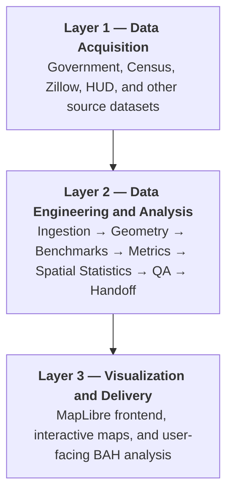
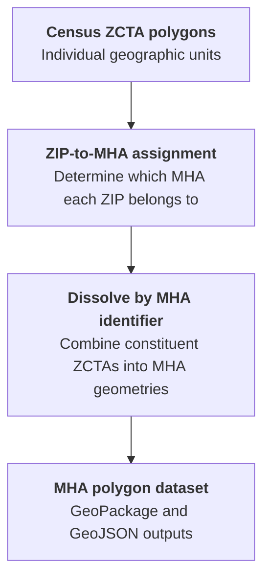

# BAH Atlas — Layer 2: Data Processing and Analytical Pipeline

Layer 2 is the data engineering, geospatial processing, and statistical analysis component of BAH Atlas.

Its job is to take the raw datasets collected in Layer 1 and transform them into a validated, reproducible collection of geospatial data, housing-cost benchmarks, statistical measurements, and map-ready files that Layer 3 can consume.

The overall architecture is:



Layer 2 is an offline Python pipeline. It does not depend on live API calls when someone uses the eventual web application. Its outputs are static files that can be served through a CDN. Layer 2 is not simply preparing data for a map: it is performing the actual research calculations that make the map meaningful.

## 1. The complete workflow

The repository divides Layer 2 into eight functional stages (2.1 - 2.8). These are tracked as B1–B31, with some numbers reserved for optional or subsequently scrapped work.

| Stage | Components | Primary responsibility |
| --- | --- | --- |
| 2.1 Ingestion | B1–B5 | Convert source data into standardized tables |
| 2.2 Geometry | B6–B7, B28 | Construct area polygons and vector tiles |
| 2.3 Benchmarks | B8–B10, B29 | Calculate local housing-cost benchmarks |
| 2.4 Ownership costs | B11, B30 | Estimate monthly costs of owning a home |
| 2.5 Computed metrics | B12–B15 | Measure BAH adequacy and financial gaps |
| 2.6 Spatial statistics | B16–B19 | Identify spatial clustering and explanatory relationships |
| 2.7 Frontend payload | B20–B22, B31 | Package data for the web application |
| 2.8 QA and enrichment | B23–B27 | Validate results, add context, and produce analytical outputs |

The stages follow the repository's work breakdown structure. A few nodes are discussed with the stage they support: B24 and B27 with the spatial statistics and B28 with the geometry, although the WBS files them under 2.8 and 2.7.

## 2. Stage 2.1 — Data ingestion (B1–B5)

**Purpose:** Convert the original source files into consistent, machine-readable datasets.

Layer 1 obtains the original data. Layer 2 ingestion translates those datasets into standardized tables that subsequent processing stages can consume.

The important architectural principle is that downstream scripts should not need to understand the original format of every external source.

### B1 — ZIP-to-MHA crosswalk

*Core component*

This produces `zip_mha.csv`.

Its purpose is to establish the relationship between individual ZIP codes and their corresponding Military Housing Areas.

Conceptually:

```text
ZIP Code       MHA
80901          CO018
80902          CO018
80903          CO018
...
```

This is one of the most important datasets in the entire project.

The reason is that the various data sources do not share a common geographic identifier:

- DTMO publishes BAH information using ZIP-to-MHA assignments.
- Zillow publishes housing information at the ZIP level.
- Census publishes geographic boundaries at the ZCTA level.
- HUD publishes Fair Market Rent information using geographic identifiers.

B1 establishes the geographic relationship needed to combine those sources. Think of this like a common denominator when adding fractions.

### B2 — Geographic ZIP-to-MHA crosswalk

Produces `zip_mha_geo.csv`.

This is the same crosswalk limited to the 299 real MHAs, with no County Cost Group or territory ZIPs.

The polygon builder (B6) reads only this file, so it can never pick up a County Cost Group or territory ZIP by accident.

### B3 — MHA names

Produces `mha_names.csv`.

This translates MHA identifiers into human-readable names.

For example, an identifier such as `CO018` needs to be associated with its corresponding published MHA name.

This is important because the frontend should not have to independently maintain a geographic naming database.

### B4 — BAH rates

Produces `bah_rates.csv`.

This parses the DTMO BAH ASCII release into a normalized rate table.

The important dimensions are:

- MHA
- Pay grade
- Dependency status
- Monthly BAH amount

This is the authoritative BAH rate dataset used throughout the analytical pipeline.

### B5 — BAH rate components

Produces `rate_components.csv`.

This processes the DTMO BAH Rate Component Breakdown.

The important distinction is that BAH is not simply a housing-cost number. It incorporates a member cost share and a housing/utilities allocation.

B5 provides the rent/utilities relationship used to adjust Zillow's rent benchmark.

ZORI does not include utilities. Consequently, comparing raw ZORI directly against BAH would not be an apples-to-apples comparison.

The pipeline uses the DoD rent/utilities breakdown to gross up the rent benchmark.

> **Why this stage matters:** It establishes a standardized geographic, financial, and housing-rate foundation. Without it, the remaining stages would need to repeatedly parse source-specific formats and reconcile geographic identifiers independently.

## 3. Stage 2.2 — Geospatial construction (B6–B7, B28)

**Purpose:** Construct the geographic boundaries that represent Military Housing Areas and prepare them for web mapping.

This is where the project transitions from primarily tabular data processing into GIS.

### B6 — MHA polygon construction

*Core component*

B6 creates the MHA polygon geometries.

The important detail is that DoD does not provide an authoritative polygon dataset defining the boundaries of every MHA.

Instead, the pipeline reconstructs these boundaries using:

1. Census 2020 ZIP Code Tabulation Area (ZCTA) boundaries.
2. The DTMO ZIP-to-MHA crosswalk.
3. A spatial dissolve operation.

The conceptual process is:



For example, suppose MHA `CO018` contains 20 assigned ZIP codes.

The pipeline identifies the corresponding ZCTA geometries and dissolves them into one MHA feature.

The result is a single geographic entity representing the MHA rather than 20 individual geographic units.

The output is not necessarily a contiguous polygon. An MHA can consist of multiple disconnected polygon parts.

> **Important distinction:** A ZIP code and a ZCTA are not the same geographic object. ZCTAs are Census approximations of ZIP code areas. The project uses ZCTAs as the available geographic representation of the ZIP assignments.

This means the resulting MHA boundaries are reconstructed analytical boundaries, not official DoD boundary definitions.

### B28 — County Cost Group and territory polygons

This extends the geometry construction to areas that are not conventional MHAs.

The project identifies three geographic classes:

| Class | Identifier | Count |
| --- | --- | --- |
| MHA | State-based codes, e.g. `CO018` | 299 |
| County Cost Group | `ZZ###` | 39 |
| Territory/unknown | `XX###` | 1 |

**Why is B28 necessary?**

DoD also assigns BAH rates to locations that are not represented by conventional MHAs.

If the map only contained the 299 MHAs, those locations would be absent.

B28 therefore applies the same ZIP-to-ZCTA dissolve methodology to the County Cost Groups and territory bucket.

There is an important qualification: these additional polygons are explicitly labeled non-authoritative.

The project does not pretend that these are official geographic boundaries.

### B7 — Vector tile generation

B7 converts the geometries into a PMTiles archive.

The output is `areas_2026.pmtiles`.

The pipeline uses Tippecanoe to generate the vector tiles.

An important architectural decision was made on October 18, 2026: instead of maintaining separate tile layers for MHAs and County Cost Groups, all areas are combined into one vector layer called `areas`.

The resulting 2026 tile dataset contains:

- 299 MHA features
- 39 County Cost Group features
- 1 territory feature
- 339 total geographic features

Each feature contains two essential properties:

- `code`
- `class`

For example:

```json
{
  "code": "CO018",
  "class": "mha"
}
```

The `code` property is the join key used later by the frontend.

The `class` property distinguishes MHAs, CCGs, and the territory bucket.

The tiles deliberately contain no financial attributes.

This is an important design choice: geometry and financial data are maintained independently. Layer 3 joins them using the geographic identifier.

The tiles use zoom levels 2–10, with MapLibre handling overzooming beyond that.

## 4. Stage 2.3 — Housing-cost benchmarks (B8–B10, B29)

**Purpose:** Determine what adequate housing actually costs in each MHA.

This is one of the most analytically important parts of Layer 2.

The project needs an independent housing-cost benchmark against which BAH can be evaluated.

The fundamental problem is that BAH is calculated using a housing-cost methodology, but the project wants to independently measure how well the resulting allowance performs.

The pipeline therefore incorporates multiple external housing datasets.

### B8 — Zillow Observed Rent Index (ZORI)

*Core component*

B8 calculates rent benchmarks at the MHA level using Zillow's Observed Rent Index.

The input data is ZIP-level.

The pipeline needs to translate that into an MHA-level value.

Conceptually:

$$
\text{Rent}_{\text{MHA}} = \operatorname{Median}\left(\text{Rent}_{\text{ZIP}_1}, \text{Rent}_{\text{ZIP}_2}, \ldots, \text{Rent}_{\text{ZIP}_n}\right)
$$

The median is useful because ZIP-level rent distributions can be highly skewed.

A single expensive ZIP should not necessarily dominate the benchmark for an entire MHA.

However, this is a ZIP-level median, not a housing-stock-weighted average. That distinction matters when interpreting the results.

#### Utilities adjustment

ZORI measures rent, not rent plus utilities.

B5 provides the DoD rent/utilities component breakdown.

The pipeline uses that breakdown to estimate the utilities-inclusive housing cost.

This creates a benchmark that is more comparable to the housing cost underlying BAH.

### B9 — Zillow Home Value Index (ZHVI)

B9 calculates home-value benchmarks at the MHA level.

The input is ZIP-level ZHVI data.

The pipeline aggregates these values into MHA-level benchmarks using the same general ZIP-to-MHA approach.

This dataset is the foundation for the ownership-cost calculations.

Rent and home ownership are deliberately treated as separate analytical modes.

### B10 — HUD Fair Market Rent / Small Area Fair Market Rent

B10 incorporates HUD's FY2026 Small Area Fair Market Rent (SAFMR) dataset.

The purpose is to introduce an independent federal housing-affordability reference.

HUD SAFMR provides a useful comparison because it offers geographically differentiated rental benchmarks, including bedroom-specific values.

This allows the project to ask:

- Does BAH adequately cover Zillow-observed rent?
- Does the result change when using HUD's affordability benchmark?
- Are apparent gaps dependent on the benchmark selected?

SAFMR is a sensitivity benchmark, not the primary housing-cost measure.

### B29 — Rent benchmark by home type

This is an important expansion beyond the original E-5/O-3 research profiles.

The initial research could use one standard housing benchmark for each profile.

However, the eventual map is intended to allow users to select different housing types.

B29 creates rent benchmarks for the six DoD housing types:

| Code | Housing type |
| --- | --- |
| `apt1` | 1-bedroom apartment |
| `apt2` | 2-bedroom apartment |
| `th2` | 2-bedroom townhouse |
| `th3` | 3-bedroom townhouse |
| `sfh3` | 3-bedroom single-family home |
| `sfh4` | 4-bedroom single-family home |

It uses Zillow's multifamily and single-family rent series to distinguish building types.

It also uses HUD SAFMR bedroom ratios to estimate bedroom-related differences within an MHA.

One particularly important decision is that Zillow's all-homes ZORI is used as the reference for a two-bedroom townhouse, with the building-type and bedroom adjustments applied to derive other housing types.

Zillow publishes single-family and multifamily rents only by metro area, so each ZIP takes its metro's building-type ratio (decision D21).

Where metro-level information is unavailable, the pipeline uses a national fallback and records a caveat.

**Correction (D34, 7 Nov 2026).** A sense check against local rents in Colorado Springs showed the first method overstated single-family homes. Zillow's single-family ÷ all-homes ratio compares a typical single-family rental (about three bedrooms) with a typical home of any kind (smaller), so it already contains a size difference. Multiplying it by the HUD bedroom ratio counted the extra bedrooms twice: Colorado Springs' 3-bedroom single-family rent came out at $2,163 × 1.391 × 1.324 = $3,982 a month, against about $2,000–$2,800 asked locally and a HUD 3-bedroom Fair Market Rent of $2,420.

B29 now compares building types at equal bedrooms. Each Zillow type series is placed at its own typical bedroom count (multifamily two, single-family three) and the size difference is taken out before the bedroom ratio is applied:

$$
\text{factor}_{\text{equal size}} = \frac{\text{ZORI}_{\text{type}}}{\text{ZORI}_{\text{all}}} \times \frac{\text{SAFMR}_{2\text{BR}}}{\text{SAFMR}_{k\text{BR}}}
$$

At equal bedrooms Zillow's single-family rents sit at or slightly below the all-homes rent scaled by HUD's ratios (192 of 289 MHAs, median 5% below). A house that rents for less than a townhouse with the same bedrooms would make DoD's ladder fall with rank, so B29 holds a single-family home at the townhouse of the same bedrooms in those MHAs and records the measured value beside it. Colorado Springs is one of them: its 3-bedroom single-family rent is now $3,008, the same as its 3-bedroom townhouse (the measured value is $2,863). Across all MHAs, single-family rents fall by a median of 18%. Apartments and townhouses, and with them E-5's rent benchmark and the research findings, do not change.

> **Why B29 matters:** It allows the system to evaluate BAH against different housing standards instead of assuming every service member occupies the same type of residence.

## 5. Stage 2.4 — Homeownership costs (B11, B30)

**Purpose:** Estimate the monthly cost of purchasing and owning a home in each MHA.

Renting is only half of the housing-affordability question.

The project also measures whether BAH can support homeownership.

This requires considerably more than simply comparing BAH to a monthly mortgage payment.

### B11 — Ownership monthly cost

B11 combines:

- Zillow home values (B9)
- Mortgage rates (A7)
- Property tax rates (Census ACS, A9)
- Homeowners insurance premiums (Treasury FIO, A8)
- Ownership configuration (`ownership.json`)

The result is an estimated monthly ownership cost.

The key concept is PITI:

| Component | Meaning |
| --- | --- |
| P | Principal |
| I | Interest |
| T | Property taxes |
| I | Homeowners insurance |

The project also accounts for mortgage insurance where applicable.

The mortgage rate comes from Freddie Mac's Primary Mortgage Market Survey: the mean 30-year rate over the same months as the home values (6.31% for January–July 2026).

The loan modelled is a VA purchase loan, first use: 0% down, the 2.15% funding fee financed into the loan, a 30-year term, and no mortgage insurance.

Property tax rates are calculated from Census ACS data:

$$
\text{TaxRate}_{\text{MHA}} = \frac{\sum \text{PropertyTaxes}}{\sum \text{OwnerOccupiedPropertyValues}}
$$

This is important because the pipeline uses the sum of the underlying aggregates rather than calculating a median of ZIP-level tax rates.

Insurance comes from the U.S. Treasury Federal Insurance Office's ZIP-level homeowners insurance data.

The 2026 implementation uses the 2022 values from the 2018–2022 publication without scaling them to 2026.

This is an explicit limitation documented in the project.

### B30 — Ownership cost by home type

B30 extends the ownership model to the six housing types.

It uses:

- ZHVI building-type data
- Bedroom-specific ZHVI data
- B11's ownership-cost calculations
- The project's home-type configuration

The objective is to estimate the cost of purchasing each type of home.

Zillow does not provide a dedicated townhouse home-value index.

The project therefore estimates the townhouse building-type factor as the midpoint between the condo/co-op and single-family factors.

This preserves the expected ordering of housing costs:

$$
\text{Condo} < \text{Townhouse} < \text{SingleFamily}
$$

The ordering holds in every MHA except 10 where the condo/co-op value is above the single-family value (IN338, KY430, MD458, MI148, MI156, NY215, OH233, PA253, WI318, WV322). B30 flags these MHAs, and their townhouse cannot sit between the two in DoD's order.

The project also distinguishes between:

- PITI alone
- PITI plus estimated utilities

This distinction matters because the overall affordability comparison should account for housing-related expenses beyond the mortgage itself.

For MHAs with home-value data but no usable ZORI data, the project falls back to PITI alone and explicitly labels the result `piti_only_no_zori`.

**Correction (D34, 7 Nov 2026).** The same review found two faults here. First, the method scaled bedrooms from two, but Zillow's all-homes value matches the three-bedroom value almost exactly (ratio 1.003, median of 20,431 ZIPs), so every home with more than two bedrooms was priced as if its extra rooms came on top of a three-bedroom value. Second, as in B29, the single-family ÷ all-homes ratio already carried a size difference before the bedroom ratio was applied.

B30 now treats the all-homes value as a three-bedroom home and places each Zillow type series at its own typical size (condo/co-op two bedrooms, single-family three), so the townhouse midpoint is taken between condo and single-family values of the same size. The pipeline measures these sizes on every run and stops if the data no longer sit nearest the configured counts. Apartments do not change; townhouses and single-family homes fall, by roughly a sixth and a quarter at the national median.

> **Why this stage matters:** It creates an ownership benchmark that can be compared against BAH using the same general adequacy framework as rental housing.

## 6. Stage 2.5 — Computed BAH adequacy metrics (B12–B15)

**Purpose:** Quantify whether BAH actually covers the cost of adequate housing.

This is the core analytical engine of the entire project.

Everything before this stage prepares the data. Everything after this stage packages, analyzes, or visualizes the results.

The project has two primary research profiles:

- E-5 with dependents.
- O-3 with dependents.

It evaluates both profiles under two housing scenarios:

- Renting.
- Buying.

That creates four primary analytical scenarios for each MHA.

### 6.1 The statutory foundation

The project is built around the statutory design of BAH under 37 U.S.C. 403(b)(3).

The fundamental relationship is:

$$
\text{BAH} = \text{LocalHousingCost} - \text{MemberCostShare}
$$

The member cost share is based on 5% of the national average housing cost for the applicable pay grade.

This is important because the member cost share is not simply 5% of the housing cost in each individual MHA.

It is a nationally determined dollar amount.

Consequently, the percentage of local housing costs covered by BAH varies geographically.

The project measures that variation.

### 6.2 B12 — Rent coverage ratio

B12 calculates how well BAH covers the rental benchmark.

The primary metric is:

$$
\boxed{\text{AdequacyRatio} = \frac{\text{BAH} + \text{MemberCostShare}}{\text{LocalHousingCost}}}
$$

The target is:

$$
\text{AdequacyRatio} = 1.00
$$

Interpretation:

| Ratio | Interpretation |
| --- | --- |
| 1.10 | 110% of the local cost is covered under the statutory design |
| 1.00 | Exactly meets the statutory design |
| 0.95 | 5% below the statutory design |
| 0.90 | 10% below the statutory design |
| 0.80 | 20% below the statutory design |

**Why add the member cost share back to BAH?**

Because the project is testing the statutory design, not simply measuring how much of the rent is paid by the government.

Consider a hypothetical example:

- Monthly rent and utilities: $2,200
- BAH: $1,950
- Member cost share: $125

Then:

$$
\frac{1950 + 125}{2200} = 0.9432
$$

The adequacy ratio is approximately 94.32%.

The area is therefore approximately 5.68% below the statutory design.

### 6.3 B13 — Rent surplus/gap

B13 converts the ratio into a dollar measurement.

The primary measurement is:

$$
\boxed{\text{DesignGap} = \text{BAH} + \text{MemberCostShare} - \text{LocalHousingCost}}
$$

Using the previous example:

$$
1950 + 125 - 2200 = -125
$$

The result is a negative $125.

This means the combined allowance and member contribution fall $125 short of the benchmark.

There is also a descriptive metric:

$$
\text{Surplus} = \text{BAH} - \text{LocalHousingCost}
$$

The distinction is important:

- `design_gap_usd` measures the difference against the statutory design.
- `surplus_usd` measures the difference between BAH alone and the full housing cost.

These are not interchangeable.

### 6.4 B14 — Buy coverage ratio

B14 performs the same calculation using the homeownership benchmark.

Instead of using rental costs, it uses the estimated monthly cost of owning a home.

$$
\text{AdequacyRatio}_{\text{buy}} = \frac{\text{BAH} + \text{MemberCostShare}}{\text{OwnershipCost}}
$$

This allows the project to compare rental adequacy against ownership adequacy.

For example, an MHA might have:

- Adequate rental coverage.
- Inadequate homeownership coverage.

That is a meaningful finding because it distinguishes between the ability to rent locally and the ability to purchase locally.

### 6.5 B15 — Buy surplus/gap

B15 calculates the ownership version of the dollar gap.

$$
\text{DesignGap}_{\text{buy}} = \text{BAH} + \text{MemberCostShare} - \text{OwnershipCost}
$$

It also calculates the descriptive surplus:

$$
\text{Surplus}_{\text{buy}} = \text{BAH} - \text{OwnershipCost}
$$

Together, B12–B15 generate the primary financial measurements used throughout the project.

### 6.6 The seven metrics available to the map

The data contract defines seven map metrics.

| Metric | Purpose | Classification |
| --- | --- | --- |
| `adequacy_ratio` | Measures statutory-design adequacy | Primary |
| `design_gap_usd` | Dollar gap against statutory design | Primary |
| `coverage_ratio` | BAH divided by housing cost | Descriptive |
| `surplus_usd` | BAH minus housing cost | Descriptive |
| `flat95_gap` | Tests the fixed 95% interpretation | Sensitivity |
| `safmr_adequacy_ratio` | Adequacy using HUD SAFMR | Sensitivity |
| `safmr_design_gap_usd` | Dollar gap using HUD SAFMR | Sensitivity |

The sensitivity measurements are particularly important.

The statutory model is not the same as simply assuming BAH should cover 95% of every local housing market.

The project preserves that alternative interpretation:

$$
\text{Flat95Gap} = \frac{\text{BAH}}{\text{Cost}} - 0.95
$$

This provides a useful comparison between:

1. The actual statutory design.
2. A simplified fixed-95% coverage assumption.

It also allows the project to determine whether the conclusions depend on the selected housing benchmark.

## 7. Stage 2.6 — Spatial statistics (B16–B19)

**Purpose:** Determine whether geographic differences in BAH adequacy are spatially clustered and investigate what might explain those differences.

This is where the project moves beyond describing financial differences and begins investigating their spatial distribution.

There are two distinct research questions:

- **H1:** Are BAH adequacy gaps spatially clustered?
- **H2:** What factors are associated with those gaps?

These are addressed through different analytical methods.

### B16 — Spatial weights matrix

Before calculating spatial statistics, the pipeline needs to understand which MHAs are spatial neighbors.

B16 constructs the spatial weights matrix using the MHA polygon geometry.

The project uses a K-nearest-neighbors approach with k = 6, over the 289 CONUS MHAs. Alaska and Hawaii are excluded because they have no neighbors over land.

Conceptually, every MHA is represented as an observation, and its nearest neighboring MHAs are identified.

The resulting relationship can be represented as:

$$
W_{ij} =
\begin{cases}
1 & \text{if area } j \text{ is a neighbor of } i \\
0 & \text{otherwise}
\end{cases}
$$

This binary matrix is what the pipeline stores. Moran's I and LISA use it row-standardized, and Getis-Ord Gi* uses it binary.

The matrix establishes the geographic relationships used by the subsequent statistical calculations.

This is important because spatial autocorrelation is fundamentally different from ordinary correlation.

Two MHAs may have similar adequacy ratios, but the project wants to know whether geographically neighboring MHAs systematically exhibit similar values.

### B17 — Global Moran's I

*Primary H1 test*

Moran's I measures global spatial autocorrelation.

It determines whether similar adequacy values tend to occur near each other.

The general interpretation is:

| Moran's I | Interpretation |
| --- | --- |
| Positive | Similar values tend to cluster geographically |
| Approximately zero | No substantial global spatial autocorrelation |
| Negative | Dissimilar values tend to be neighbors |

For this project:

- Positive Moran's I suggests areas with similar BAH adequacy tend to be geographically grouped.
- Negative Moran's I suggests neighboring areas tend to have dissimilar adequacy.
- A statistically significant result provides evidence that the observed spatial pattern is unlikely under the spatial-randomness null model.

The calculation uses the spatial weights matrix from B16.

The project uses permutation-based significance testing, with 99,999 permutations as the recorded default.

This is important because Moran's I alone does not establish statistical significance.

The permutation procedure establishes a reference distribution against which the observed result is evaluated.

### B18 — Local Indicators of Spatial Association (LISA) and Getis-Ord Gi*

*Local spatial analysis*

B18 moves from a national perspective to individual geographic areas.

Global Moran's I tells you whether spatial clustering exists overall.

It does not tell you where those clusters occur.

LISA provides that additional detail.

The project identifies four local spatial relationships:

| Classification | Meaning |
| --- | --- |
| HH | High values surrounded by high values |
| LL | Low values surrounded by low values |
| HL | High values surrounded by low values |
| LH | Low values surrounded by high values |

For the project, these classifications are applied to the adequacy gap.

A hypothetical example:

Suppose several neighboring MHAs have adequacy ratios of:

```text
0.72    0.76    0.79
0.74    0.77    0.81
0.75    0.73    0.78
```

This might represent an LL cluster if the surrounding areas also exhibit statistically significant low values.

Conversely, a geographically isolated MHA with unusually high adequacy surrounded by low-adequacy MHAs could represent an HL relationship.

B18 also calculates Getis-Ord Gi*.

Gi* identifies statistically significant concentrations of high and low values.

It classifies areas as:

- Hotspots.
- Coldspots.
- Not statistically significant.

> **An important methodological decision:** the project distinguishes between exploratory local results and confirmatory global results.

Local LISA results with pseudo p-values below 0.05 are shown as exploratory. The project also applies the Benjamini-Hochberg false-discovery-rate correction.

Areas surviving that correction receive a separate significance indicator.

This is important because performing hundreds of local statistical tests creates a multiple-comparisons problem.

Without correction, some apparently significant clusters may occur simply by chance.

### B19 — Spatial regression

B19 addresses the second research question: what factors are associated with the geographic differences in BAH adequacy?

This is a different type of analysis from Moran's I and LISA.

Instead of simply identifying clusters, regression investigates relationships between adequacy gaps and explanatory variables.

The current H2 model uses three explanatory variables:

| Variable | Source | What it represents |
| --- | --- | --- |
| Rent level | B8 / Zillow ZORI | Local rental-market cost |
| Rent growth | A3 / Zillow ZORI history | Change in local rent over time |
| Population density | B24 / Census ACS | Urbanicity |

The dependent variable is the E-5 rental adequacy gap.

The analysis uses:

1. Ordinary Least Squares (OLS).
2. Residual spatial autocorrelation testing.
3. Lagrange Multiplier diagnostics.
4. Spatial lag and spatial error model selection.
5. Model diagnostics and sensitivity analysis.

The project uses PySAL's `spreg` functionality.

The Anselin model-selection procedure is used to determine whether the data supports an ordinary regression, spatial lag model, or spatial error model.

The two spatial models address different phenomena:

- **Spatial lag:** The dependent variable in neighboring areas may influence the dependent variable in the area being studied.
- **Spatial error:** Spatially correlated unobserved factors may affect the regression residuals.

The pipeline also evaluates:

- Variance Inflation Factors (VIF).
- Condition number.
- Residual Moran's I.
- Model AIC.
- Sensitivity to population-weighted density.
- Sensitivity to the O-3 profile.
- Sensitivity to a three-year rather than five-year rent-growth window.

An important finding from the 2026 run is that the model-selection diagnostics did not unambiguously distinguish between the spatial lag and spatial error specifications.

Rather than forcing a choice, the pipeline reports both models and marks the model form as ambiguous.

That is a good analytical safeguard.

It prevents the project from presenting a model-selection result with greater certainty than the evidence supports.

### B24 — Population density

B24 supplies the population-density measurement needed by B19.

It uses Census ACS population and Census land area.

The calculation is:

$$
\text{Density}_{\text{MHA}} = \frac{\sum \text{Population}_{\text{ZCTA}}}{\sum \text{LandArea}_{\text{ZCTA}}}
$$

It also calculates a population-weighted density measure for sensitivity analysis.

One important implementation detail: land area comes from the Census ZCTA attribute table, rather than calculating area from the generalized map polygons.

This avoids using cartographically generalized geometries for a statistical measurement.

### B27 — Hotspot overlay

B27 packages the local spatial results for the frontend.

It contains:

- LISA cluster classification.
- LISA pseudo p-value.
- FDR significance flag.
- Getis-Ord classification.
- Global Moran's I results.

It is keyed by MHA code, just like the primary attribute payload.

This allows the frontend to display a hotspot overlay independently of the primary adequacy choropleth.

B27 is explicitly limited to the research profiles and their statutory views.

It does not attempt to generate local spatial statistics for all 322 possible rank/dependency/home-type combinations.

## 8. Stage 2.7 — Frontend data packaging (B20–B22, B31)

**Purpose:** Convert all of the analytical results into a stable interface that Layer 3 can consume.

This stage is particularly important from a software architecture perspective.

Layer 3 should not need to understand how BAH rates were calculated, how ZIP codes were aggregated, or how spatial statistics were performed.

Layer 3 should receive finished data.

The project accomplishes this through a formal Interface Control Document (ICD).

The ICD is version 1.1.0, approved November 1, 2026.

It defines exactly what Layer 2 delivers and what Layer 3 is permitted to do with that data.

### B20 — Attribute payload

*Primary data interface*

Output: `payload_2026.json`

B20 packages the calculated financial metrics.

It combines:

- BAH rates from B4.
- Rent and ownership metrics from B12–B15.
- MHA names and classifications.
- Profile definitions.
- Area-level caveats.
- Build identification information.

The resulting structure is organized by area code.

A simplified example:

```json
{
  "bah_year": 2026,
  "profiles": ["e5_dep", "o3_dep"],
  "modes": ["rent", "buy"],
  "areas": {
    "CO018": {
      "class": "mha",
      "e5_dep": {
        "rent": {
          "status": "ok",
          "bah_monthly": 2112,
          "cost_share_monthly": 126,
          "cost_monthly": 2139,
          "adequacy_ratio": 1.0463,
          "design_gap_usd": 99
        }
      }
    }
  }
}
```

The values above are illustrative examples from the contract, not a claim about a current live calculation.

An important point: B20 does not calculate new financial metrics.

It packages values already produced by the upstream analytical stages.

#### Handling missing data

One of the better design decisions in the ICD is the explicit handling of missing values.

Rather than simply omitting fields, the project uses:

- `null` for missing measurements.
- A status code explaining why the measurement is unavailable.
- Caveat identifiers explaining relevant limitations.

For example:

| Status | Meaning |
| --- | --- |
| `ok` | Benchmark available |
| `no_zori` | No usable Zillow rent data |
| `piti_only_no_zori` | Ownership benchmark available, but utilities cannot be estimated |
| `no_home_value` | No usable home-value benchmark |
| `ccg_no_benchmark` | County Cost Group has no independent housing benchmark |
| `no_rate` | No applicable BAH rate |

This prevents the frontend from treating missing measurements as zero.

That distinction is critical in statistical visualization.

A zero is a real numerical value. A missing value is an absence of an observation.

### B21 — UI metadata

Output: `ui_metadata_2026.json`

B21 contains the information necessary to display and interpret the metrics.

This includes:

- Metric names and descriptions.
- Classification thresholds.
- Colors.
- Legend labels.
- Area names.
- Status descriptions.
- Caveat descriptions.
- Source attribution.
- Benchmark date windows.
- Housing-type labels.
- Pay-grade dropdown options.
- Dependency-status dropdown options.

One of the most important architectural decisions is that the frontend does not hardcode classification breaks, colors, or explanatory text.

Instead, Layer 3 reads these values from B21.

This means a change to the classification scheme can be made in Layer 2 configuration and propagated into the frontend without rewriting the frontend's classification logic.

### B22 — Build manifest

Output: `build_manifest_2026.json`

B22 records the provenance of the build.

It captures:

- Input files.
- SHA-256 checksums.
- Configuration checksums.
- Pipeline stage manifests.
- Software versions.
- Python package versions.
- Tippecanoe version.
- Git commit identifier.
- Build timestamp.
- Benchmark periods.
- Spatial statistics settings.
- Output geometry counts.

This is effectively the provenance record for the entire analytical build.

If someone questions a particular MHA's calculated adequacy ratio, the project has a mechanism for tracing the output back to the source files and software configuration used to produce it.

### B31 — Rank × dependents × home-type grid

*Major expansion of the project*

B31 is arguably the most significant functional expansion of Layer 2.

Originally, the research focused on two profiles:

- E-5 with dependents.
- O-3 with dependents.

B31 expands the eventual map so users can select their own rank, dependency status, and housing type.

The available dimensions are:

| Dimension | Options |
| --- | --- |
| Enlisted grades | 9 |
| Warrant officer grades | 5 |
| Officer grades | 9 |
| Dependency status | 2 |
| Housing types | 7, including DoD standard |

Therefore:

$$
23 \times 2 \times 7 = 322
$$

There are 322 possible rank/dependency/housing combinations per housing mode.

With rent and buy:

$$
322 \times 2 = 644
$$

That is 644 possible views.

Precomputing every possible area and selection combination would produce a substantially larger dataset.

Instead, B31 carries the necessary inputs:

- BAH for each rank and dependency status.
- Member cost share.
- Housing costs for each of the six actual housing types.
- DoD housing standards.
- The relationship between the housing types and each rank's standard.

The browser then calculates the selected view.

The formula is:

$$
\boxed{\text{AdequacyRatio} = \frac{\text{BAH} + \text{CostShare}}{\text{SelectedHousingCost}}}
$$

For an individual housing type, the cost is simply the benchmark for that type.

For a DoD standard that falls between two housing types, the system interpolates between the two benchmarks.

For example, if a grade's standard is 98% of the way between a three-bedroom townhouse and a three-bedroom single-family home:

$$
\text{Cost} = \text{Cost}_{\text{Townhouse}} + 0.98\left(\text{Cost}_{\text{SingleFamily}} - \text{Cost}_{\text{Townhouse}}\right)
$$

There are also standards above the highest benchmark, which are handled using a cost multiplier.

An important distinction is made in the UI:

- Selecting the DoD standard measures statutory-design adequacy.
- Selecting a different housing type measures how far BAH goes toward affording that particular home.

The second is an affordability comparison, not the statutory BAH test.

> **Why B31 matters:** It transforms the project from a research map with two predefined profiles into a potentially useful tool for service members across the enlisted, warrant officer, and commissioned officer pay structures.

## 9. Stage 2.8 — Quality assurance and research documentation (B23, W1, W2)

**Purpose:** Ensure that the analytical outputs are correct, reproducible, and suitable for publication.

This stage is what makes Layer 2 more than a collection of Python scripts.

It establishes whether the results can be trusted.

### B23 — QA and validation report

B23 generates a report that evaluates the pipeline's outputs.

It checks several categories of issues:

**Data integrity**

- Required outputs exist.
- Expected geographic identifiers are present.
- Every expected area is represented.
- Input and output relationships are consistent.

**Financial calculations**

- Calculated values agree with their expected formulas.
- Missing values have appropriate status codes.
- The E-5 and O-3 calculations can be reproduced using the frontend's grid formula.
- Rounding and classification behavior are consistent.

**Geographic integrity**

- Every delivered polygon has a corresponding payload entry.
- Every applicable payload entry has a polygon.
- Geographic classifications are valid.
- The CCG and territory geometry limitations are documented.

**Statistical integrity**

- Spatial outputs have the expected inputs.
- Recorded statistical parameters are available.
- Model diagnostics and warnings are included.

**Interface integrity**

- JSON files conform to the ICD.
- Required fields exist.
- Status codes are valid.
- The build identifiers match.
- SHA-256 checksums are consistent.

B23 is especially important because it tests the relationship between the precomputed research profiles and the dynamic B31 grid.

For example, selecting E-5 with dependents and the DoD standard in the browser should reproduce the same result as the original B12–B15 calculations.

If those calculations disagree, the pipeline should not pass QA.

### W1 — Layer 2 research and methodology writeup

W1 documents how the source datasets become the final research results.

It includes:

- Data processing methodology.
- Benchmark construction.
- Statistical methodology.
- Limitations.
- Decisions made during development.

This is the narrative explanation of the research; it's what you are reading right now!

### W2 — Interface Control Document

W2 is the formal contract between Layer 2 and Layer 3.

It defines:

- Delivered files.
- File formats.
- Data structures.
- Field names.
- Data types.
- Missing-value behavior.
- Classification conventions.
- Versioning.
- Validation requirements.
- Frontend responsibilities.

This is particularly valuable because it means Layer 3 can be developed independently of the internal implementation of Layer 2.

The frontend does not need to know which Python module produced a value. It only needs to know that the value conforms to the contract.

## 10. What Layer 2 actually delivers

The final output is not one massive dataset.

It is a collection of complementary files.

**Layer 2 delivery directory:**

```text
delivery/2026/
├── areas_2026.pmtiles         339 geographic features; vector geometry
├── payload_2026.json          BAH and housing adequacy measurements
├── ui_metadata_2026.json      Classification, labels, colors, caveats, attribution
├── hotspots_2026.json         Local spatial statistics and cluster classifications
├── grid_2026.json             Rank, dependency, and housing-type inputs
├── build_manifest_2026.json   Build provenance and input checksums
├── SHA256SUMS                 Integrity verification for all six delivered files
├── qa_2026.md                 The B23 QA report for this build
└── qa_2026_manifest.json      The B23 verdict and the hashes it checked
```

These files are generated under `data/processed/handoff/` first.

They are copied into `delivery/2026/` only after the delivery requirements pass.

The separation is intentional: the handoff is the working output, while the delivery directory is a frozen, validated release.

## 11. How the entire pipeline is executed

The project uses a Makefile to orchestrate the processing.

Here is the documented sequence:

| Command | Responsibility |
| --- | --- |
| `make fetch` | Obtain Layer 1 source datasets |
| `make check-config` | Validate project configuration |
| `make geometry` | Run ingestion and MHA geometry |
| `make components` | Generate rent/utilities components |
| `make non-mha` | Construct CCG and territory geometry |
| `make tiles` | Generate PMTiles |
| `make basemap` | Generate basemap cutout |
| `make benchmarks` | Calculate rent and ownership benchmarks |
| `make metrics` | Calculate BAH adequacy metrics |
| `make spatial` | Calculate spatial statistics |
| `make regression` | Calculate population density and spatial regression |
| `make test` | Run unit tests |
| `make handoff` | Generate Layer 3 interface files |
| `make evidence` | Collect manifests and test results |
| `make verify` | Verify recorded SHA-256 checksums |
| `make qa` | Generate QA report |
| `make layer2` | Run the complete Layer 2 pipeline |
| `make deliver-check` | Evaluate the delivery requirements |
| `make deliver` | Publish the validated handoff into delivery |

The important distinction is that `make layer2` runs the processing from existing raw inputs. It does not fetch new source data.

That separation makes it possible to distinguish data acquisition from data processing.

## 12. The simplest way to understand Layer 2

Imagine someone asks:

> "Does my BAH adequately cover housing costs at Fort Carson?"

Layer 2 is responsible for being able to answer that question using reproducible data.

It needs to:

1. Identify the MHA associated with the location.
2. Retrieve the appropriate BAH rate.
3. Determine the applicable member cost share.
4. Calculate the local rental benchmark.
5. Calculate the local ownership benchmark.
6. Adjust for utilities, property taxes, insurance, and mortgage costs.
7. Calculate the statutory adequacy ratio.
8. Calculate the dollar surplus or deficit.
9. Determine whether similar deficits occur in neighboring MHAs.
10. Package the results so the frontend can display them.

And it needs to do all of that in a way that can be reproduced and independently checked.

Without Layer 2, BAH Atlas would essentially be a map. With Layer 2, it becomes a reproducible geospatial research system.

---

*This write-up was written entirely by Wendell McGowan, however Claude Opus 5.5 assisted in formatting it into a markdown format and formatted formulas in a visually pleasing manner.*
