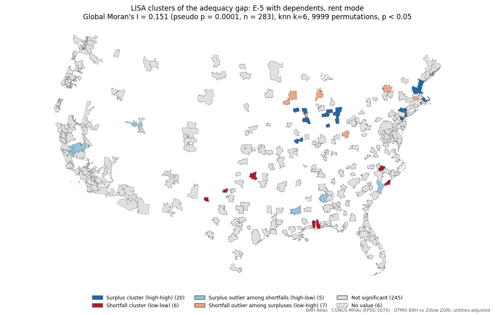

# Progress note — 24 October 2026 · M5 2.6 Spatial Statistics

_Follows the [progress-note template](TEMPLATE.md) · all notes and milestone status: [progress index](README.md) · full tracker: [WBS](../WBS.md). Tables marked *generated* are filled from `nodes.csv`, git history and `docs/evidence/`; parts marked *author* are written by hand._

## 1. Reporting date and milestone

| | |
|---|---|
| **Reporting date** | Sat 24 Oct 2026 (covers 18 Oct – 24 Oct) |
| **Milestone** | **M5** 2.6 Spatial Statistics — [WBS](../WBS.md#milestones) · [GitHub milestone](https://github.com/TheWendarr/bah-atlas/milestones?state=all&q=M5%3A) |
| **Due** | Sat 24 Oct 2026 |
| **Status** | ✅ Complete 18 Oct (6 days early) — 3 / 3 required nodes complete |
| **Nodes in milestone** | B16, B17, B18 (optional: B19) |

**In brief**:

This week completed M5. B16 builds k-nearest-neighbour spatial weights for the 289 CONUS MHAs, and B17 and B18 test the B12–B15 adequacy gap for spatial clustering with global Moran's I, LISA and Getis-Ord Gi\*; `make spatial` runs all three. The primary test rejects spatial randomness, which supports hypothesis H1: MHAs where BAH sits above or below its statutory design tend to sit near other MHAs in the same position.

On 18 Oct, planning for M6 began. The decisions in part 4 set the scope of the Layer 2 to Layer 3 handoff, and the node-by-node plan is in [`docs/plans/m6-plan.md`](../plans/m6-plan.md).

## 2. Completed work and evidence

Nodes completed this reporting period, with the commits, tests, and pipeline results that support each one.

| Node | Issue | Done | Commits | Tests | Results |
|---|---|---|---|---|---|
| **B16** Spatial weights matrix | [#29](https://github.com/TheWendarr/bah-atlas/issues/29) | 18 Oct | [`a526527`](https://github.com/TheWendarr/bah-atlas/commit/a526527), [`be15ac5`](https://github.com/TheWendarr/bah-atlas/commit/be15ac5) | [test_spatial.py](../../tests/test_spatial.py) | [weights_manifest.json](../evidence/weights_manifest.json) |
| **B17** Global Moran's I | [#30](https://github.com/TheWendarr/bah-atlas/issues/30) | 18 Oct | [`a526527`](https://github.com/TheWendarr/bah-atlas/commit/a526527), [`0954408`](https://github.com/TheWendarr/bah-atlas/commit/0954408) | [test_spatial.py](../../tests/test_spatial.py) | [spatial_stats_manifest.json](../evidence/spatial_stats_manifest.json), [mha_lisa_e5_dep_rent_map.png](../evidence/mha_lisa_e5_dep_rent_map.png) |
| **B18** LISA / Getis-Ord Gi* clusters | [#31](https://github.com/TheWendarr/bah-atlas/issues/31) | 18 Oct | [`a526527`](https://github.com/TheWendarr/bah-atlas/commit/a526527), [`0954408`](https://github.com/TheWendarr/bah-atlas/commit/0954408) | [test_spatial.py](../../tests/test_spatial.py) | [spatial_stats_manifest.json](../evidence/spatial_stats_manifest.json), [mha_lisa_e5_dep_rent_map.png](../evidence/mha_lisa_e5_dep_rent_map.png) |

Unit tests at last `make evidence`: `2026-10-18 — Ran 38 tests in 21.749s — OK` ([log](../evidence/tests.txt)).

**What changed and what the results show**:

The primary test (E-5 with dependents, rent mode, `adequacy_gap`, n = 283) gives **Moran's I = 0.152, pseudo p = 0.0001** from 9,999 permutations, against an expected value of −0.004 under spatial randomness. Adequacy gaps are positively autocorrelated, so H1 holds for the primary test. Clustering is stronger for the O-3 contrast profile (I = 0.255) and in buy mode (E-5: 0.397; O-3: 0.482), and all eight tests are significant at pseudo p = 0.0001.

Locally, LISA at p < 0.05 marks 20 MHAs as surplus clusters (high-high), 6 as shortfall clusters (low-low) and 12 as outliers (5 high-low, 7 low-high); Gi\* finds 27 hot spots and 11 cold spots. Only 2 of the LISA results remain significant after the false-discovery-rate correction, so the global pattern is clear while the individual cluster locations need care (part 4). For E-5 renters, surplus clusters outnumber shortfall clusters about three to one, consistent with the 17 Oct result that 44 of the 289 MHAs with a value fall below the statutory design.

Results: [`spatial_stats_manifest.json`](../evidence/spatial_stats_manifest.json) (headline, all eight tests, and the global I re-run at k = 4, k = 8 and under queen contiguity) · [`weights_manifest.json`](../evidence/weights_manifest.json) · 38 unit tests pass, including a hand-worked Moran's I.

## 3. Remaining work

Optional nodes in this milestone: **B19** Spatial regression.

**Other work before this milestone is done**:

None for M5. Follow-on:

- B19 (spatial regression, optional) is deferred until after M6. H2 will be tested with a reduced chain (A9 → B24 → B19); see part 4.

## 4. Blockers and decisions

| Node | Type | What happened | What I tried / decided | Input needed |
|---|---|---|---|---|
| B16 | Decision | MHA polygons are dissolves of ZCTAs, and the County Cost Group counties between MHAs are not part of B6. Under queen contiguity, 81 of the 289 CONUS MHAs have no neighbour and the map splits into 122 disconnected pieces ([weights manifest](../evidence/weights_manifest.json)). | Used k-nearest-neighbour weights (k = 6) between MHA representative points (EPSG:5070) as the primary weights: one connected graph, median distance to the 6th neighbour 198 km, maximum 724 km (MT175 to WA313; 25 links exceed 500 km). Queen contiguity, k = 4 and k = 8 are reported as sensitivity checks on the global I. Commit [`be15ac5`](https://github.com/TheWendarr/bah-atlas/commit/be15ac5). | No |
| B16–B18 | Decision | The research proposal is CONUS-first, and Alaska and Hawaii MHAs have no neighbours over land. | Excluded the 10 AK and HI MHAs (AK400–AK405, HI407–HI409, HI414) from 2.6. Six more CONUS MHAs have no ZORI benchmark (B12 status `no_zori`), so each rent test runs on 283 MHAs. | No |
| B18 | Decision | Multiple testing. At p < 0.05, 38 of 283 MHAs are classed as local clusters or outliers in the primary test (20 HH, 6 LL, 5 HL, 7 LH); about 14 would be expected by chance alone. After the Benjamini–Hochberg false-discovery-rate correction, 2 remain. The global result does not have this problem: one test, Moran's I = 0.152, pseudo p = 0.0001. | The cluster map and the A13 classes use p < 0.05, the usual LISA convention, and every MHA also carries an FDR flag (`lisa_fdr_significant`) in the results file. Gi\* gives a consistent picture (27 hot, 11 cold). Commit [`0954408`](https://github.com/TheWendarr/bah-atlas/commit/0954408). | **Decided 18 Oct (option C):** LISA classes at p < 0.05 are shown and labelled exploratory, and the FDR-significant MHAs are marked. The global Moran's I remains the confirmatory test of H1. Before B27 is built, B18 is rerun with 99,999 permutations: at 9,999 the smallest attainable local p (0.0002) sits above the FDR cut-off for the top-ranked MHA (about 0.00018), so the current count of two may be a resolution limit. |
| B12–B18 | Decision | Follow-up to the 17 Oct test-variable question. B17 now measures how much spatial clustering the flat-95% reading adds. In rent mode Moran's I is higher for `flat95_gap` than for `adequacy_gap` (E-5: 0.173 vs 0.152; O-3: 0.259 vs 0.255). In buy mode it is lower (E-5: 0.367 vs 0.397; O-3: 0.462 vs 0.482). | Kept `adequacy_gap` as the primary 2.6 variable and `flat95_gap` as the sensitivity test. The rent result matches the expectation that a fixed 95% target adds clustering; the difference is small. | **Resolved 18 Oct:** the project uses `adequacy_gap` as its primary test variable; the research question and method in [`research-proposal.md`](../research-proposal.md) are updated to match. |
| B19 | Decision | Spatial regression (optional) depends on B24 (ACS) and B25 (BEA RPP), which are also optional and not started. | Deferred B19 until after M6. M5 is complete without it, but hypothesis H2 (what the gaps are associated with) stays untested until it is done. On 18 Oct chose a **reduced H2 chain**: the adequacy gap is regressed on rent level (B8), rent growth (ZORI history, A3) and urbanicity (population density from ACS, A9 → B24). BEA Regional Price Parities (A10, B25) are scrapped: they exist only for states and metro areas, and their rent component repeats the rent-level variable. A9, B24 and B19 started. | No |
| B26 | Decision | H3 hex overlay (optional). BAH is a flat amount tied to administrative areas, so a hex surface would misrepresent it. | Scrapped 18 Oct; the id stays in the tracker. | No |
| B28 | Decision | County Cost Groups (39 ZZ codes, 20,465 ZIPs) and the territory bucket (one XX code, 214 ZIPs) have BAH assignments but no DoD polygon. | Added B28 to M6: polygons from the same ZIP → ZCTA dissolve as B6, labelled non-authoritative wherever shown, and kept out of the spatial statistics. **CCGs carry their BAH rates only:** they have no DoD rent/utilities split and many rural ZIPs have no ZORI, so their adequacy metrics are blank with a visible caveat (`ccg_no_benchmark`). Alaska and Hawaii MHAs are mapped with their values and stay out of the spatial statistics. | No |
| A8 | Decision | B11 property tax and insurance are national placeholders. | Started A8: ACS aggregate tax ÷ aggregate value by ZCTA, and Treasury FIO ZIP-level premiums with NAIC state fallback. **A8 is now required**, because B11 → B18 (buy mode) are rebuilt on it before the M6 payload; it is tracked under M6 so M1 stays closed. **Insurance is used as published** (2018–2022 ZIP data, 2022 NAIC state averages) without scaling to 2026; the understatement of 2026 premiums is documented as a limitation. The buy-mode change will be reported. | No |
| B20 | Decision | The payload format had to be fixed before Layer 3 can start. | **Contents:** every value carries its inputs (BAH, cost share, local cost, status), and the sensitivity values (`flat95_gap`, SAFMR adequacy ratio and design gap) are selectable map layers as well as popup numbers. **Conventions:** semantic `schema_version` plus `bah_year`; ratios to 4 decimals, dollars whole; one file nested by area code; `null` plus a status for missing values; caveat ids in the data with their text in B21; a `build_id` pointing to the B22 build manifest. Where buy mode has no ZORI utilities estimate, PITI is used with a note. Draft contract in the [M6 plan](../plans/m6-plan.md#2-draft-data-contract-b20). | No |
| B27 | Decision | Cluster results could sit inside the B20 payload or in their own file. | Separate file (B27), keyed like B20, so B20 holds measured values only and the statistical classes can change without touching it. B27 started. | No |

## 5. Next steps and dates

open required nodes and the date each is due by its milestone (⚠️ = already past due):

| Due by | Node | Issue | Milestone |
|---|---|---|---|
| Fri 30 Oct | **A8** Property tax and insurance reference | [#8](https://github.com/TheWendarr/bah-atlas/issues/8) | M6 |
| Fri 30 Oct | **B20** Attribute payload JSON (data contract) | [#33](https://github.com/TheWendarr/bah-atlas/issues/33) | M6 |
| Fri 30 Oct | **B21** UI metadata JSON | [#34](https://github.com/TheWendarr/bah-atlas/issues/34) | M6 |
| Fri 30 Oct | **B22** Build manifest JSON | [#35](https://github.com/TheWendarr/bah-atlas/issues/35) | M6 |
| Fri 30 Oct | **B28** CCG and territory polygons (ZCTA dissolve, non-authoritative) | issue created at next `make wbs-sync` | M6 |
| Fri 30 Oct | **B23** QA / validation report | [#36](https://github.com/TheWendarr/bah-atlas/issues/36) | M6 |
| Fri 30 Oct | **W1** Layer 2 writeup (how Layer 1 becomes Layer 3) | [#41](https://github.com/TheWendarr/bah-atlas/issues/41) | M6 |

**Next concrete step** the first piece of work, with the date it will be done:

- Wed 21 Oct — B28: County Cost Group and territory polygons.
- Sat 24 Oct — A8, A9 and B24: locality tax, insurance and population density per MHA; B11 → B18 rerun on them, with B18 at 99,999 permutations.
- Wed 28 Oct — B20: data-contract schema and attribute payload JSON for the 299 MHAs and 39 County Cost Groups, keyed by area code, carrying the B12–B15 metrics and sensitivity layers for both profiles and both modes (CCGs: BAH rate only).

The node-by-node plan for M6 is in [`docs/plans/m6-plan.md`](../plans/m6-plan.md).

**Schedule**: no change to milestone dates since the previous note ([`milestones.csv`](../wbs/milestones.csv) unchanged since 18 Oct).

---

*AI-assistance disclosure: Claude (Anthropic) assisted in building tooling, wrote the B16–B18 pipeline code with the author. The decisions and status reporting are the author's.*
