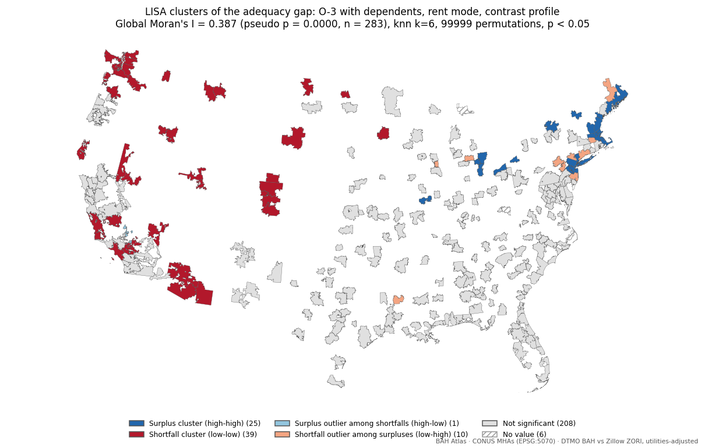

# Progress note — 24 October 2026 · M5 2.6 Spatial Statistics

_Follows the [progress-note template](TEMPLATE.md) · all notes and milestone status: [progress index](README.md) · full tracker: [WBS](../WBS.md). Tables marked *generated* are filled from `nodes.csv`, git history and `docs/evidence/`; parts marked *author* are written by hand._

## 1. Reporting date and milestone

| | |
|---|---|
| **Reporting date** | Sat 24 Oct 2026 (covers 18 Oct – 24 Oct) |
| **Milestone** | **M5** 2.6 Spatial Statistics — [WBS](../WBS.md#milestones) · [GitHub milestone](https://github.com/TheWendarr/bah-atlas/milestones?state=all&q=M5%3A) |
| **Due** | Sat 24 Oct 2026 |
| **Status** | ✅ Complete 18 Oct (6 days early) — 3 / 3 required nodes complete |
| **Nodes in milestone** | B16, B17, B18 |

**In brief** *(author)*:

This period closed M5 and finished every Layer 2 node except the write-up. M5 (B16–B18) closed on 18 Oct, six days early: the primary test gives Moran's I = 0.152 (pseudo p = 0.00001), which supports hypothesis H1 that adequacy gaps cluster in space.

The rest of Layer 2 was built and run on the 2026 data the same day: local property tax and insurance (A8, A9), polygons for the County Cost Groups and territory bucket (B28), the data contract (W2), the five handoff files (B20–B22, B27, with B7 rebuilt), population density (B24), the H2 spatial regression (B19) and the QA report (B23). `make layer2` rebuilds all of it from the raw downloads, and the QA report passed every check. M6 now waits only on the W1 write-up and the delivery commit.

## 2. Completed work and evidence

*Generated.* Nodes completed this reporting period, with the commits, tests, and pipeline results that support each one.

| Node | Issue | Done | Commits | Tests | Results |
|---|---|---|---|---|---|
| **A8** Property tax and insurance reference | [#8](https://github.com/TheWendarr/bah-atlas/issues/8) | 18 Oct | [`5bbb562`](https://github.com/TheWendarr/bah-atlas/commit/5bbb5622eb5ca94ad377da984999be866bf9dc05), [`3440748`](https://github.com/TheWendarr/bah-atlas/commit/3440748d3bace0c8587513426c750e60e373628e), [`bf65c6b`](https://github.com/TheWendarr/bah-atlas/commit/bf65c6b969c85ab7ddfc5ac82f806b91bcf1c54d), [`d60125b`](https://github.com/TheWendarr/bah-atlas/commit/d60125b02286d955030f39ffbbf8948a7b089a1c) | [test_benchmarks.py](../../tests/test_benchmarks.py), [test_handoff.py](../../tests/test_handoff.py) | [mha_tax_insurance_manifest.json](../evidence/mha_tax_insurance_manifest.json), [fetch_manifest.json](../evidence/fetch_manifest.json) |
| **A9** Census ACS context | [#9](https://github.com/TheWendarr/bah-atlas/issues/9) | 18 Oct | [`21bd696`](https://github.com/TheWendarr/bah-atlas/commit/21bd6965489fd13b42e9dff90d1ac94e44d631c2), [`5bbb562`](https://github.com/TheWendarr/bah-atlas/commit/5bbb5622eb5ca94ad377da984999be866bf9dc05), [`d60125b`](https://github.com/TheWendarr/bah-atlas/commit/d60125b02286d955030f39ffbbf8948a7b089a1c), [`aa73f33`](https://github.com/TheWendarr/bah-atlas/commit/aa73f33b78c883531d59782009acb19e797b2f1a) | [test_benchmarks.py](../../tests/test_benchmarks.py), [test_fetch.py](../../tests/test_fetch.py), [test_handoff.py](../../tests/test_handoff.py) | [fetch_manifest.json](../evidence/fetch_manifest.json) |
| **A14** DoD BAH housing standards by grade and dependency status | — | 24 Oct | *A14-A16: housing standards for all 46 cells; Zillow type and bedroom series in the fetcher* (24 Oct) | [test_check_config.py](../../tests/test_check_config.py), [test_home_types.py](../../tests/test_home_types.py) | [standards_check_manifest.json](../evidence/standards_check_manifest.json) (copied by the next `make evidence`) |
| **B16** Spatial weights matrix | [#29](https://github.com/TheWendarr/bah-atlas/issues/29) | 18 Oct | [`bf65c6b`](https://github.com/TheWendarr/bah-atlas/commit/bf65c6b969c85ab7ddfc5ac82f806b91bcf1c54d), [`a526527`](https://github.com/TheWendarr/bah-atlas/commit/a526527e1ee1a32b2850439d3b47327b427531a3), [`be15ac5`](https://github.com/TheWendarr/bah-atlas/commit/be15ac5d5b4b03194592c1b4a4eb94383cb7b8c5) | [test_handoff.py](../../tests/test_handoff.py), [test_regression.py](../../tests/test_regression.py), [test_spatial.py](../../tests/test_spatial.py) | [weights_manifest.json](../evidence/weights_manifest.json) |
| **B17** Global Moran's I | [#30](https://github.com/TheWendarr/bah-atlas/issues/30) | 18 Oct | [`bf65c6b`](https://github.com/TheWendarr/bah-atlas/commit/bf65c6b969c85ab7ddfc5ac82f806b91bcf1c54d), [`a526527`](https://github.com/TheWendarr/bah-atlas/commit/a526527e1ee1a32b2850439d3b47327b427531a3), [`0954408`](https://github.com/TheWendarr/bah-atlas/commit/09544081d5a1202e035799f953aa61f57fa8ac69) | [test_handoff.py](../../tests/test_handoff.py), [test_spatial.py](../../tests/test_spatial.py) | [spatial_stats_manifest.json](../evidence/spatial_stats_manifest.json), [mha_lisa_e5_dep_rent_map.png](../evidence/mha_lisa_e5_dep_rent_map.png), [mha_lisa_o3_dep_rent_map.png](../evidence/mha_lisa_o3_dep_rent_map.png) |
| **B18** LISA / Getis-Ord Gi* clusters | [#31](https://github.com/TheWendarr/bah-atlas/issues/31) | 18 Oct | [`bf65c6b`](https://github.com/TheWendarr/bah-atlas/commit/bf65c6b969c85ab7ddfc5ac82f806b91bcf1c54d), [`a526527`](https://github.com/TheWendarr/bah-atlas/commit/a526527e1ee1a32b2850439d3b47327b427531a3), [`0954408`](https://github.com/TheWendarr/bah-atlas/commit/09544081d5a1202e035799f953aa61f57fa8ac69) | [test_handoff.py](../../tests/test_handoff.py), [test_spatial.py](../../tests/test_spatial.py) | [spatial_stats_manifest.json](../evidence/spatial_stats_manifest.json), [mha_lisa_e5_dep_rent_map.png](../evidence/mha_lisa_e5_dep_rent_map.png), [mha_lisa_o3_dep_rent_map.png](../evidence/mha_lisa_o3_dep_rent_map.png) |
| **B19** Spatial regression | [#32](https://github.com/TheWendarr/bah-atlas/issues/32) | 18 Oct | [`d3a5381`](https://github.com/TheWendarr/bah-atlas/commit/d3a5381ae185e61e9db085a109e5acf74dc88a06), [`518cc2f`](https://github.com/TheWendarr/bah-atlas/commit/518cc2fa8f2d45e1ca167b4c5d1cefa7cc66a8f4), [`a024b6f`](https://github.com/TheWendarr/bah-atlas/commit/a024b6f7cfea75a26a9e952a48df8d14db404d2e) | [test_deliver.py](../../tests/test_deliver.py), [test_qa.py](../../tests/test_qa.py), [test_regression.py](../../tests/test_regression.py) | [regression_manifest.json](../evidence/regression_manifest.json) |
| **B20** Attribute payload JSON (data contract) | [#33](https://github.com/TheWendarr/bah-atlas/issues/33) | 18 Oct | [`d3a5381`](https://github.com/TheWendarr/bah-atlas/commit/d3a5381ae185e61e9db085a109e5acf74dc88a06), [`decdf5f`](https://github.com/TheWendarr/bah-atlas/commit/decdf5f400c71edde6f624e4de5c10cd7f6201cd), [`21e918c`](https://github.com/TheWendarr/bah-atlas/commit/21e918c10996f8f6f3fe3c5fc64f065444c2a9f8) | [test_handoff.py](../../tests/test_handoff.py), [test_qa.py](../../tests/test_qa.py) | [build_manifest_2026.json](../evidence/build_manifest_2026.json), [qa_2026_manifest.json](../evidence/qa_2026_manifest.json) |
| **B21** UI metadata JSON | [#34](https://github.com/TheWendarr/bah-atlas/issues/34) | 18 Oct | [`d3a5381`](https://github.com/TheWendarr/bah-atlas/commit/d3a5381ae185e61e9db085a109e5acf74dc88a06), [`decdf5f`](https://github.com/TheWendarr/bah-atlas/commit/decdf5f400c71edde6f624e4de5c10cd7f6201cd), [`21e918c`](https://github.com/TheWendarr/bah-atlas/commit/21e918c10996f8f6f3fe3c5fc64f065444c2a9f8) | [test_handoff.py](../../tests/test_handoff.py), [test_qa.py](../../tests/test_qa.py) | [build_manifest_2026.json](../evidence/build_manifest_2026.json), [qa_2026_manifest.json](../evidence/qa_2026_manifest.json) |
| **B22** Build manifest JSON | [#35](https://github.com/TheWendarr/bah-atlas/issues/35) | 18 Oct | [`d3a5381`](https://github.com/TheWendarr/bah-atlas/commit/d3a5381ae185e61e9db085a109e5acf74dc88a06), [`decdf5f`](https://github.com/TheWendarr/bah-atlas/commit/decdf5f400c71edde6f624e4de5c10cd7f6201cd), [`21e918c`](https://github.com/TheWendarr/bah-atlas/commit/21e918c10996f8f6f3fe3c5fc64f065444c2a9f8) | [test_deliver.py](../../tests/test_deliver.py), [test_handoff.py](../../tests/test_handoff.py) | [build_manifest_2026.json](../evidence/build_manifest_2026.json) |
| **B28** CCG and territory polygons (ZCTA dissolve, non-authoritative) | [#66](https://github.com/TheWendarr/bah-atlas/issues/66) | 18 Oct | [`5ebcfcc`](https://github.com/TheWendarr/bah-atlas/commit/5ebcfcce0e8dda0fb6ee5ffeea7e85caecea65e5), [`c040e50`](https://github.com/TheWendarr/bah-atlas/commit/c040e5041d58dc2bb79519e18da2692e164cdd36), [`444e59d`](https://github.com/TheWendarr/bah-atlas/commit/444e59d974fb46a71c7fbc8e305bdf707b77a0ec), [`2fff743`](https://github.com/TheWendarr/bah-atlas/commit/2fff7438da453dce507fa4b6a36bfd60de127f9d) | [test_geometry.py](../../tests/test_geometry.py), [test_handoff.py](../../tests/test_handoff.py), [test_tiles.py](../../tests/test_tiles.py) | [non_mha_2026_geometry_manifest.json](../evidence/non_mha_2026_geometry_manifest.json) |
| **B23** QA / validation report | [#36](https://github.com/TheWendarr/bah-atlas/issues/36) | 18 Oct | [`d3a5381`](https://github.com/TheWendarr/bah-atlas/commit/d3a5381ae185e61e9db085a109e5acf74dc88a06), [`3ec6751`](https://github.com/TheWendarr/bah-atlas/commit/3ec6751e646085acfb744ae8717521baac775011) | [test_deliver.py](../../tests/test_deliver.py), [test_qa.py](../../tests/test_qa.py) | [qa_2026_manifest.json](../evidence/qa_2026_manifest.json) |
| **B24** ACS context join | [#37](https://github.com/TheWendarr/bah-atlas/issues/37) | 18 Oct | [`d3a5381`](https://github.com/TheWendarr/bah-atlas/commit/d3a5381ae185e61e9db085a109e5acf74dc88a06), [`21bd696`](https://github.com/TheWendarr/bah-atlas/commit/21bd6965489fd13b42e9dff90d1ac94e44d631c2) | [test_benchmarks.py](../../tests/test_benchmarks.py), [test_qa.py](../../tests/test_qa.py), [test_regression.py](../../tests/test_regression.py) | [mha_density_manifest.json](../evidence/mha_density_manifest.json) |
| **B27** Hotspot overlay payload | [#40](https://github.com/TheWendarr/bah-atlas/issues/40) | 18 Oct | [`d3a5381`](https://github.com/TheWendarr/bah-atlas/commit/d3a5381ae185e61e9db085a109e5acf74dc88a06), [`decdf5f`](https://github.com/TheWendarr/bah-atlas/commit/decdf5f400c71edde6f624e4de5c10cd7f6201cd), [`21e918c`](https://github.com/TheWendarr/bah-atlas/commit/21e918c10996f8f6f3fe3c5fc64f065444c2a9f8) | [test_handoff.py](../../tests/test_handoff.py), [test_qa.py](../../tests/test_qa.py) | [build_manifest_2026.json](../evidence/build_manifest_2026.json), [qa_2026_manifest.json](../evidence/qa_2026_manifest.json) |
| **W2** Data contract (Layer 2 to Layer 3 ICD) | [#67](https://github.com/TheWendarr/bah-atlas/issues/67) | 18 Oct | [`7f51d5d`](https://github.com/TheWendarr/bah-atlas/commit/7f51d5d8024f3034659a53977765f474a08a53fa), [`1288ba8`](https://github.com/TheWendarr/bah-atlas/commit/1288ba8870469152a1e965e145d3facc89211a44) | — (a document; its checks run in [test_handoff.py](../../tests/test_handoff.py)) | [data-contract.md](../data-contract.md) (ICD 1.0.3) |

Unit tests at last `make evidence`: `2026-10-18 — Ran 102 tests in 33.686s — OK` ([log](../evidence/tests.txt)).

Milestone commits: [`41cd6cc`](https://github.com/TheWendarr/bah-atlas/commit/41cd6cc0be8a802f5a9f5f331a427793924976e4) M5: record hash verification and the clean rebuild in the 24 Oct note, [`9f2c379`](https://github.com/TheWendarr/bah-atlas/commit/9f2c3799a3bac6c20b56ef61b9a340436a470908) M5: rebuild B1-B18 on values-only configs; evidence and hashes current, [`abca5e0`](https://github.com/TheWendarr/bah-atlas/commit/abca5e076c250ef54a6ef71e5547099b01e82180) Close M5: spatial statistics; progress note 24 Oct

**What changed and what the results show** *(author)*:

**H1 (M5).** The primary test (E-5 with dependents, rent mode, `adequacy_gap`, n = 283) gives **Moran's I = 0.152, pseudo p = 0.00001** (99,999 permutations) against an expected value of −0.004 under spatial randomness, so H1 holds. Clustering is stronger for the O-3 contrast (I = 0.255) and in buy mode (E-5 0.359, O-3 0.434 after A8). Locally, LISA at p < 0.05 marks 20 surplus clusters, 6 shortfall clusters and 12 outliers; only 2 survive the false-discovery-rate correction, so the local classes are reported as exploratory (D2). Results: [`spatial_stats_manifest.json`](../evidence/spatial_stats_manifest.json).

**Local tax and insurance (A8).** Every MHA now has its own property-tax rate (0.23–2.40%, median 0.79%) and 2022 homeowners premium ($833–$15,638, median $1,625); none needed a state fallback. Buy-mode adequacy fell slightly (E-5 median 0.779 → 0.768; O-3 159 → 166 MHAs below design); rent results did not change. Results: [`mha_tax_insurance_manifest.json`](../evidence/mha_tax_insurance_manifest.json).

**The handoff (B7, B20–B22, B27, W2).** The five files Layer 3 will read validate against the data contract (ICD checks 3–8, 0 failures): 339 areas (299 MHAs, 39 County Cost Groups, 1 territory bucket) in one tile layer of 17.2 MB, and an attribute payload of 451 KB (44 KB compressed). Results: [`build_manifest_2026.json`](../evidence/build_manifest_2026.json).

**QA (B23).** The report passed: contract checks, every recorded hash, provenance (built from committed code), and three MHAs traced from their ZIP values to the payload with every ratio recomputed (KS105, NC182, MA119). It raised three notes, all recorded in part 4. Results: [`qa_2026_manifest.json`](../evidence/qa_2026_manifest.json).

**H2 (B19, B24).** E-5 with dependents, rent mode; coefficients from the model chosen in each run ([`regression_manifest.json`](../evidence/regression_manifest.json)):

| Run | n | Model | ln rent | Rent growth (per pp a year) | ln density |
|---|---|---|---|---|---|
| Primary: 5-year growth | 201 | Spatial error (form ambiguous; lag also fitted) | −0.211 (p < 0.001) | −0.014 (p = 0.051; lag form p = 0.034) | +0.083 (p < 0.001) |
| 3-year growth | 255 | Spatial error | −0.167 (p < 0.001) | −0.010 (p = 0.036) | +0.077 (p < 0.001) |
| Population-weighted density | 201 | Spatial lag (form ambiguous) | −0.157 (p < 0.001) | −0.011 (p = 0.106) | +0.097 (p < 0.001) |
| O-3 contrast | 201 | Spatial lag (form ambiguous) | −0.190 (p < 0.001) | −0.009 (p = 0.284) | +0.050 (p < 0.001) |

Read on the primary run: a 10% higher rent goes with an adequacy gap about 2 percentage points lower, and twice the population density with a gap about 6 points higher; both hold in every run. Rent growth points the same way (faster growth, smaller surplus) but is weak and depends on the sample and model form. The spatial error term (λ = 0.48) absorbs the residual clustering (residual Moran's I 0.180 under OLS, −0.004 after). Two caveats travel with these numbers: part of the rent-level effect is mechanical, because the gap divides by the same ZORI; and the 5-year sample leaves out 82 rural MHAs that sit closer to the design point (part 4).

**The grid (D18–D20), 24 Oct.** All five grid patches are written; the code is tested on fixtures and waits for the Zillow downloads and a `make layer2` on the workstation.

- **A14, DoD's housing standards (complete).** The standard and member cost share for all 46 rank and dependents cells are in `config/housing_standards.json`, from the DTMO BAH Primer (January 2022; the 2018 edition agrees, and CNA's April 2026 evaluation confirms the anchor points). As a check, `make standards` rebuilds every 2026 BAH rate from the six anchor cells and the table: all 46 cells pass in all 299 MHAs, with a median residual of $1–4 a month. The check also showed how DoD prices the cells above the highest profile (O-6 and O-7 with dependents, O-7 without): as a 1–2% markup on that profile's cost. One cell drifts (part 4).
- **A15, rent by building type.** Zillow publishes single-family and multifamily rent indexes only by metro area, not by ZIP. The proposed approach (D21, part 4) uses each ZIP's metro ratio, with the national ratio where an MHA has no ZIP in such a metro.
- **B29, B30: benchmarks for six home types.** Rent: B8 × the building-type ratio × HUD's bedroom ratio. Buy: B9 × Zillow's condo or single-family ratio × its bedroom ratio, then the B11 mortgage model. Both scripts check on every run that the 2 BR townhouse equals B8 and B11 to the cent, so E-5, H1 and H2 cannot move.
- **B12–B15.** Each research profile is now measured against its own DoD standard. O-3's becomes 98% of the way from a 3 BR townhouse to a 3 BR single-family home and is recomputed on the next run.
- **B31 and ICD 1.1.0.** The grid file carries BAH for every rank and the six benchmarks per mode, and the browser computes each view with the formula in the ICD (section 5b). In the fixture, that formula run on B31 gives exactly B20's values for both research profiles. B23 now checks this on the real data and traces two off-standard cells (E-1 in a 4 BR single-family home, O-9 in a 1 BR apartment).

**The grid on the 2026 data (24 Oct, evening).** `make layer2` passed end to end after the fixes in part 4: B23 PASS, contract checks 3–8 with 0 failures, the browser formula on B31 identical to B20 in all 1,356 research-profile views, and the two off-standard grid cells traced in KS105. E-5 did not move: rent adequacy median 1.136 (44 of 289 MHAs below design), buy 0.768, Moran's I 0.1515 with the same 20/6/5/7 clusters, and the same B19 coefficients. With metro names matched by principal city, 351 of 379 metro names reach A15, and only 15 MHAs (apartments) and 12 (single-family) take the national rent ratio. The grid file is 348 KB.

O-3 is recomputed on its DoD standard (98% of the way from a 3 BR townhouse to a 3 BR single-family home): rent adequacy median 0.872, 229 of 289 MHAs below design; buy 0.699, 283 below. Its rent clustering rose from Moran's I 0.256 to 0.387. Part of that rise is mechanical, because the single-family rent factor is one ratio per metro, shared by neighbouring MHAs. O-3 is the contrast profile, not the H1 test, but W1 should say so.

## 3. Remaining work

*Generated* — required nodes still open in M5:

- None. Every required node in M5 is complete.

**Other work before this milestone is done** *(author)*:

None for M5; every node closed on 18 Oct.

For M6, due Fri 30 Oct, what remains is not a pipeline node:

- **W1** Layer 2 write-up ([`docs/layer2-writeup.md`](../layer2-writeup.md)): seven sections from the outline, including the record of every action and decision (D10).
- **Delivery (D10, D16, D17):** `make deliver-check`, then `make deliver` copies the validated handoff and the QA report into `delivery/2026/`, committed together with W1. Layer 3 starts after that commit.
- **ICD 1.0.3 and 1.1.0 approval** (part 4).
- **The grid run (A15, A16, B29–B31):** `make fetch`, `make layer2`, review the B23 report including section 9b, then `make done N="A15 A16 B29-B31"` and record the new files' SHA-256 in SOURCES.md and REPRODUCING.md ([plan](../plans/m6-plan.md#rank--dependents--home-type-grid-d18d20--planned-18-oct)).
- **D21** (part 4): decide how A15 handles the metro-only rent series.

## 4. Blockers and decisions

*Generated:* no milestone is past due.

*Author* — one row per blocker or decision. **Input needed** is where the instructor's answer is requested; *No* means the row is for the record.

| Node | Type | What happened | What I tried / decided | Input needed |
|---|---|---|---|---|
| B16 | Decision | MHA polygons are dissolves of ZCTAs, and the County Cost Group counties between MHAs are not part of B6. Under queen contiguity, 81 of the 289 CONUS MHAs have no neighbour and the map splits into 122 disconnected pieces ([weights manifest](../evidence/weights_manifest.json)). | Used k-nearest-neighbour weights (k = 6) between MHA representative points (EPSG:5070) as the primary weights: one connected graph, median distance to the 6th neighbour 198 km, maximum 724 km (MT175 to WA313; 25 links exceed 500 km). Queen contiguity, k = 4 and k = 8 are reported as sensitivity checks on the global I. Commit [`be15ac5`](https://github.com/TheWendarr/bah-atlas/commit/be15ac5). | No |
| B16–B18 | Decision | The research proposal is CONUS-first, and Alaska and Hawaii MHAs have no neighbours over land. | Excluded the 10 AK and HI MHAs (AK400–AK405, HI407–HI409, HI414) from 2.6. Six more CONUS MHAs have no ZORI benchmark (B12 status `no_zori`), so each rent test runs on 283 MHAs. | No |
| B18 | Decision | Multiple testing. At p < 0.05, 38 of 283 MHAs are classed as local clusters or outliers in the primary test (20 HH, 6 LL, 5 HL, 7 LH); about 14 would be expected by chance alone. After the Benjamini–Hochberg false-discovery-rate correction, 2 remain. The global result does not have this problem: one test, Moran's I = 0.152, pseudo p = 0.0001. | The cluster map and the A13 classes use p < 0.05, the usual LISA convention, and every MHA also carries an FDR flag (`lisa_fdr_significant`) in the results file. Gi\* gives a consistent picture (27 hot, 11 cold). Commit [`0954408`](https://github.com/TheWendarr/bah-atlas/commit/0954408). | **Decided 18 Oct (option C):** LISA classes at p < 0.05 are shown and labelled exploratory, and the FDR-significant MHAs are marked. The global Moran's I remains the confirmatory test of H1. Before B27 is built, B18 is rerun with 99,999 permutations: at 9,999 the smallest attainable local p (0.0002) sits above the FDR cut-off for the top-ranked MHA (about 0.00018), so the current count of two may be a resolution limit. |
| B12–B18 | Decision | Follow-up to the 17 Oct test-variable question. B17 now measures how much spatial clustering the flat-95% reading adds. In rent mode Moran's I is higher for `flat95_gap` than for `adequacy_gap` (E-5: 0.173 vs 0.152; O-3: 0.259 vs 0.255). In buy mode it is lower (E-5: 0.367 vs 0.397; O-3: 0.462 vs 0.482). | Kept `adequacy_gap` as the primary 2.6 variable and `flat95_gap` as the sensitivity test. The rent result matches the expectation that a fixed 95% target adds clustering; the difference is small. | **Resolved 18 Oct:** the project uses `adequacy_gap` as its primary test variable; the research question and method in [`research-proposal.md`](../research-proposal.md) are updated to match. |
| B19 | Decision | *(Superseded by D15, below.)* Spatial regression (optional) depends on B24 (ACS) and B25 (BEA RPP), which are also optional and not started. | Deferred B19 until after M6. M5 is complete without it, but hypothesis H2 (what the gaps are associated with) stays untested until it is done. On 18 Oct chose a **reduced H2 chain**: the adequacy gap is regressed on rent level (B8), rent growth (ZORI history, A3) and urbanicity (population density from ACS, A9 → B24). BEA Regional Price Parities (A10, B25) are scrapped: they exist only for states and metro areas, and their rent component repeats the rent-level variable. A9, B24 and B19 started. | No |
| A12–A13 | Decision | The config files mixed explanations with values. Stages record each config's SHA-256, so correcting a sentence (the files still cited retired node ids F10 and F18 and described the research question as a fixed 95% test) would have made the M4–M5 evidence stale without any number changing. | Moved the explanations to [`docs/configuration.md`](../configuration.md) and kept values only in the JSON; `make check-config` now rejects prose fields. Rebuilt B1–B18 once and confirmed with `make verify` that every recorded hash agrees and every result is unchanged. `config/ownership.json` gets the same treatment when A8 rewrites it. | No |
| B6 | Finding | The new B6 manifest counts the ZIP-to-ZCTA join dropout for the first time: 5,609 of the 20,280 ZIPs assigned to real MHAs have no ZCTA polygon (PO-box and point ZIPs). No MHA is left without a polygon (299 written). | Recorded as a known limitation; B23 reports it, and a ZIP-to-ZCTA bridge file (`--zip-to-zcta`) is the remedy if it matters for any MHA's shape. | No |
| B26 | Decision | H3 hex overlay (optional). BAH is a flat amount tied to administrative areas, so a hex surface would misrepresent it. | Scrapped 18 Oct; the id stays in the tracker. | No |
| B28 | Decision | County Cost Groups (39 ZZ codes, 20,465 ZIPs) and the territory bucket (one XX code, 214 ZIPs) have BAH assignments but no DoD polygon. | Added B28 to M6: polygons from the same ZIP → ZCTA dissolve as B6, labelled non-authoritative wherever shown, and kept out of the spatial statistics. **CCGs carry their BAH rates only:** they have no DoD rent/utilities split and many rural ZIPs have no ZORI, so their adequacy metrics are blank with a visible caveat (`ccg_no_benchmark`). Alaska and Hawaii MHAs are mapped with their values and stay out of the spatial statistics. | No |
| A8 | Decision | *(Fallback superseded by D11, below.)* B11 property tax and insurance are national placeholders. | Started A8: ACS aggregate tax ÷ aggregate value by ZCTA, and Treasury FIO ZIP-level premiums with NAIC state fallback. **A8 is now required**, because B11 → B18 (buy mode) are rebuilt on it before the M6 payload; it is tracked under M6 so M1 stays closed. **Insurance is used as published** (2018–2022 ZIP data, 2022 NAIC state averages) without scaling to 2026; the understatement of 2026 premiums is documented as a limitation. The buy-mode change will be reported. | No |
| A9 | Finding | The Census Data API now refuses requests without a key. | Registered a free key (`CENSUS_API_KEY`). The fetcher adds it to the request only, and the fetch manifest records the URL without it; a test checks that the key never reaches the manifest or an error message. | No |
| A8 | Decision | The FIO workbook has no state column, so the plan's NAIC state-average fallback would bring in a second source with a different scope (statewide HO-3 averages). | **Decided 18 Oct (D11):** an MHA with no published ZIP takes the median over the published ZIPs of every real MHA in its state, so every premium comes from one source and one year. | No |
| B21 | Decision | The map's status texts, caveat texts and source attributions needed an authored home. | **Decided 18 Oct (D12):** `config/ui_text.json`, part of A13 and read only by B21, so a wording change reruns nothing upstream. | No |
| B17–B18 | Decision | The Makefile defaulted to 9,999 permutations while the recorded run used 99,999. | **Decided 18 Oct (D13):** 99,999 is the default, so a full rebuild reproduces the recorded evidence. | No |
| B20–B27 | Decision | Where the delivered files are written. | **Decided 18 Oct (D14):** `data/processed/handoff/`, apart from the intermediate outputs. | No |
| B27 | Finding | The ICD rounded B27 p-values to 4 decimals, which shows the 99,999-permutation minimum (0.00002) as 0. | ICD 1.0.2 rounds p-values to 5 decimals. Changed before any file was produced, so no consumer is affected. | No |
| B11–B15 | Finding | Buy mode after A8 (local tax and insurance in place of the national placeholders). E-5: median adequacy 0.779 → 0.768; MHAs below design 267 → 267 of 289. O-3: median 0.985 → 0.972; below design 159 → 166. | The local figures shift costs in both directions; the O-3 count rises by 7. Rent mode does not use B11 and is unchanged. Recorded in the [coverage manifest](../evidence/coverage_metrics_manifest.json). | No |
| B17–B18 | Finding | Buy-mode clustering after A8: Moran's I E-5 0.397 → 0.359, O-3 0.482 → 0.434 (flat-95%: 0.367 → 0.327, 0.462 → 0.410); all still pseudo p = 0.00001. LISA FDR survivors, buy: E-5 34 → 29, O-3 35 → 23. | Weaker but still strong clustering: local tax and premiums vary more than the national figures, and part of that variation is not clustered. H1 holds in both modes. | No |
| B18 | Finding | **The FDR count is not a resolution limit.** At 99,999 permutations the smallest attainable local p is 0.00002, below the top-ranked cut-off. The primary test still has **2** FDR-significant MHAs (1 HL, 1 LH; cut-off p = 0.00011), as at 9,999. | The count reflects the data, so B27 marks these 2 for the primary test. The exploratory labelling of the p < 0.05 classes (D2) stands. | No |
| B14 | Finding | MA119 (Nantucket, MA) has a buy coverage ratio of 0.20 (E-5) and 0.25 (O-3), below the 0.3 sanity floor the metrics step warns on. | Checked: a genuine extreme, not a join error. Typical home value $3.1M; principal and interest $19,650 a month; tax rate 0.27%; premium $15,638 a year (median of its 2 published ZIPs, the run's highest). It has no ZORI, so it is one of the 10 PITI-only MHAs: mapped, but outside the buy summaries and the spatial tests. The warning stays. | No |
| A9 | Finding | 18,576 of the 33,772 ZCTAs in the ACS file have no usable tax or value estimate; 15,196 are usable. | Every MHA still has data (none fell back to its state). B23 will report the ZCTA coverage per MHA beside the other join counts. | No |
| Fetcher | Finding | While testing the A9 pull: a fresh download was checked by its temporary `.part` name, so the ZIP, PDF and CSV content checks only ever ran on files already on disk, never on new downloads. | Fixed: the check now uses the file type in the registry. Files already on disk are re-validated each time `make fetch` runs, so one rerun rechecks every earlier pull. | No |
| B20 | Decision | The payload format had to be fixed before Layer 3 can start. | **Contents:** every value carries its inputs (BAH, cost share, local cost, status), and the sensitivity values (`flat95_gap`, SAFMR adequacy ratio and design gap) are selectable map layers as well as popup numbers. **Conventions:** semantic `schema_version` plus `bah_year`; ratios to 4 decimals, dollars whole; one file nested by area code; `null` plus a status for missing values; caveat ids in the data with their text in B21; a `build_id` pointing to the B22 build manifest. Where buy mode has no ZORI utilities estimate, PITI is used with a note. Draft contract in the [M6 plan](../plans/m6-plan.md#2-draft-data-contract-b20). | No |
| B28 | Finding | The territory bucket was expected to be Puerto Rico. Its ZIP3 prefixes place its 214 ZIPs in Puerto Rico (ZIP3 006, 007, 009), the U.S. Virgin Islands (008), the Pacific 969 range (Guam, the Northern Mariana Islands and the freely associated states) and one 967 ZIP, which in this bucket is expected to be 96799 (American Samoa). | Kept as one area, as DTMO assigns it; its polygon spans the Caribbean and the western Pacific. Recorded in ICD section 4 (1.0.1): the map's default view is fitted to the MHAs, and these areas carry status `no_rate`. To confirm the single 967 ZIP: `grep ',XX' data/interim/bah_2026/zip_mha.csv \| grep '^967'`. | No |
| B28 | Finding | ZIP-to-ZCTA dropout in the non-MHA classes: 1,502 of 20,465 County Cost Group ZIPs and 66 of 214 territory ZIPs have no ZCTA polygon (PO-box and point ZIPs, as for B6). Every code still has a polygon. | Recorded in the B28 manifest; B23 reports it beside the B6 figure. | No |
| B7 | Finding | The rebuilt tile archive is 17.6 MB, against 4.9 MB for the MHA-only archive, because the County Cost Groups cover most of the country's rural area. | No change needed: MapLibre reads PMTiles by HTTP range request, one tile at a time, so the map never downloads the whole file. Reducing the maximum zoom is the option if hosting size matters in Layer 3. | No |
| B7, B28 | Decision | The County Cost Group and territory polygons (B28) needed a place in the tiles, and the choice fixes the join key Layer 3 uses for every value. Option A: one layer for all areas. Option B: a second layer beside B7's `mha` layer, leaving B7 unchanged. | **Decided 18 Oct (D9, option A):** B7 is rebuilt as one layer `areas` holding every area, keyed on `code` with a `class` property, in a single tippecanoe run. Option B would simplify each side of an MHA-to-CCG border separately and leave slivers, would put CCG codes in a field named `mha`, and would double every front-end join. B6 and B16–B18 do not change. | No |
| B22 | Finding | Writing the ICD showed a loop in the plan: B22 was to list the hashes of B20 and B21, while B20 and B21 carry B22's hash as `build_id`. | B22 is now written first, from the stage manifests and B7; B20, B21 and B27 follow; a `SHA256SUMS` file over all five is written last. `nodes.csv` updated to match. | No |
| B14, B20 | Finding | Decision 2.4 gives the 10 MHAs with a home value but no ZORI a buy value on PITI alone, but B14 leaves their metrics blank and B20 is meant to compute nothing. | The PITI-only metrics will be computed in B14/B15 (status `piti_only_no_zori`) during the A8 rerun, and `spatial_stats.py` will test only buy rows with status `ok`, so those MHAs stay out of the buy-mode statistics as they are now. | No |
| All | Decision | When the processed outputs enter the repository. | **Decided 18 Oct (D10):** they are added only after Layers 1 and 2 are complete, in one commit with a write-up of every action and decision behind them; Layer 3 starts after that commit (ICD section 12). | No |
| B27 | Decision | Cluster results could sit inside the B20 payload or in their own file. | Separate file (B27), keyed like B20, so B20 holds measured values only and the statistical classes can change without touching it. B27 started. | No |
| B19 | Decision | B19 was deferred to after M6, so the Layer 2 write-up would have gone out with H2 untested. | **Decided 18 Oct (D15):** B19 is done now, inside M6, and rent growth is annualised over 5 years before the B8 window (2021 → 2026, same calendar months). The script also reports VIF and a shared-denominator caveat: the gap divides by ZORI and the rent-level predictor is the log of ZORI. | No |
| All | Decision | Where the delivered files go in the repository, and what proves Layers 1–2 are complete first. | **Decided 18 Oct (D16, option B):** a frozen copy in `delivery/2026/`, changed only by a deliberate re-delivery. Tracking `data/processed/handoff/` in place was rejected: every rerun would rewrite the 17.6 MB tile archive in git history. **D17:** `make deliver` copies only when every Layer 1–2 node is complete or scrapped (W1 aside), the contract checks and `make verify` pass, B23 passes for this exact build, the build came from committed code, and W1 is written. | No |
| B23 | Finding | B22's `dirty` flag cannot show whether the handoff came from committed code: `make handoff` copies the evidence before B22 runs, so a rebuild always marks the tree dirty. | B23 and the delivery gate check the code paths directly instead: the B22 commit must be an ancestor of `HEAD`, with `pipeline/`, `config/`, `tools/`, the Makefile and requirements unchanged since and clean now. | No |
| W2 | Finding | ICD 5.5 still described `insurance_state_fallback` as the NAIC state average, which D11 replaced; check 1 named `make handoff`, which does not start from `data/raw`. | ICD 1.0.3, wording only: the D11 fallback, `make layer2` as the end-to-end run, and the delivery rules in section 12. `schema_version` moves to 1.0.3 with it (section 10), so the workstation run rebuilds the handoff under 1.0.3. Needs the author's approval (section 10). | Author approval of ICD 1.0.3 |
| B19 | Finding | First run on the 2026 data: the regression kept 201 of the 283 CONUS MHAs with a rent value. The 82 left out have no ZIP with ZORI in both the 2021 and 2026 windows, and they differ from the modelled MHAs (median adequacy gap 0.054 against 0.156; median ln density 3.83 against 5.20), so the 5-year result describes the denser, better-covered MHAs. | B19 now compares the two groups (Mann-Whitney U), warns when they differ, and reruns the primary profile with 3-year growth (2023 → 2026), which keeps more MHAs. The 5-year window stays primary (D15); W1 reports both. | No |
| B19 | Finding | Both LM tests were significant (p ≈ 0) but neither robust test was, so the decision rule could not tell a spatial lag from a spatial error process; the three runs split (error for the primary, lag for the two sensitivity runs). | B19 now marks such a choice ambiguous, fits both models, reports AIC for both and says for each predictor whether they agree. B23 lists both points as NOTE rows. | No |
| B23 | Finding | A second `make layer2` failed at `make verify`: the previous run's B23 manifest, still in `data/processed/qa/`, recorded the old handoff's hashes and was copied beside the new B22. | `make handoff` now deletes earlier B23 output first; the rerun passed every check. | No |
| B19 | Finding | H2 results on the 2026 data ([regression manifest](../evidence/regression_manifest.json)). Primary run (E-5, rent, 5-year growth, n = 201): the robust LM tests could not separate lag from error, so both were fitted; AIC favours the error model (−251.8 against −247.2, λ = 0.48). Rent level is negative and density positive in both forms; rent growth is negative but significant only in the lag form (p = 0.034; error form p = 0.051). The 3-year run (n = 255) chooses the error model outright and finds all three significant, growth included (p = 0.036). | Report rent level and density as associated with the gap, and rent growth as weak and sensitive to the sample and the model form. The 82 MHAs without 5-year growth are rural and closer to the design point (Mann-Whitney p < 0.001 on all three variables), so the 3-year run is reported beside the primary one. The rent-level coefficient carries the shared-denominator caveat. | No |
| B23 | Finding | One map value changes class through rounding: FL057, E-5 rent surplus $49.92 unrounded, $50 in B20, which crosses the $50 break. Fifteen values sit within rounding distance of a break. | As the ICD expects (section 6), the map classifies the rounded value; B23 section 5 lists the case. No change. | No |
| B23 | Finding | Hand-check of the three traced MHAs (KS105 surplus, NC182 short of design, MA119 PITI-only fallback) against the raw ZORI file and the DTMO BAH calculator. | <!-- TODO (author): result, initials and date --> | No |
| W2 | Decision | ICD 1.0.3 is a wording-only revision (the D11 insurance fallback, `make layer2` as check 1, the delivery rules in section 12) and needs the author's approval under section 10. | <!-- TODO (author): Approved <date>. --> | No |
| A15, B29 | Decision | Zillow publishes single-family and multifamily ZORI only by metro area; the plan assumed ZIP level. | **Proposed 24 Oct (D21):** each ZIP takes its metro's type ratio (type ZORI ÷ all-homes ZORI), the MHA the median over its ZIPs; where no ZIP lies in a metro with the series, the national ratio, flagged per MHA (caveat `type_factor_national`), as D11 did for insurance. Alternatives: the ZHVI type ratio as a stand-in for rent, or bedrooms-only rent. <!-- TODO (author): decide D21 --> | No |
| B23, B31 | Finding | First real run of the grid (24 Oct evening): every check passed except one. The browser formula on B31 matched B20 in 1,353 of 1,356 views; the 3 others (NC178, TX415, UT292, all O-3) were a dollar apart in cost, design gap and surplus. The O-3 blend can land on a fraction of a cent; the pipeline rounded it to cents and then to dollars, the browser once. A randomized test then found a second, rarer case: exact binary ties (a 50% blend at $613.125) round to the even digit in Python, away from zero in the contract and in JavaScript. | Fixed: a blended standard is rounded to cents before its metrics, on both paths, and all rounding is half away from zero on the exact value (ICD 1.1.0 revised before approval). `tests/test_grid_rounding.py` compares the two paths on 20,000 random standards. E-5 is unaffected except at exact ties, which `git diff docs/evidence` will show if any exist. | No |
| B29 | Finding | Only 204 of 379 metro names matched A15, so about half the MHAs took the national building-type ratio. Zillow's ZIP files use the full census name ("Atlanta-Sandy Springs-Alpharetta, GA"); its metro files use a short one ("Atlanta, GA"). | Fixed: names that do not match exactly are matched on principal city and first state; a key shared by two metros is never used. The manifest records exact, principal-city and unmatched counts. | No |
| B30 | Decision | In buy mode the 3 BR townhouse came out above the 3 BR single-family home (PITI medians $3,526 vs $3,507); rent mode orders them correctly. **Evidence from the second run (`reference_check`):** per ZIP, the all-homes ZHVI is 1.356 × the 2 BR value, 1.003 × the 3 BR value and 0.823 × the 4 BR value. The all-homes index is a 3-bedroom home's value, not a 2 BR townhouse's, so D19's reference assumption does not hold in buy mode. This reaches past the grid: B11 has priced E-5's buy benchmark at a 3 BR value since September (about 36% above a 2 BR value at the median ZIP). | **Proposed (D22):** options in the [M6 plan](../plans/m6-plan.md#1-decisions-18-oct-2026). B30 now records which bedroom count the all-homes index resembles and warns when types fall out of order. <!-- TODO (author): decide D22 --> | No |
| A14 | Finding | The 2026 rates reproduce the primer's table within 0.01 for 45 of 46 cells. E-8 without dependents is the exception: the primer says 20% of the way from a 2 BR to a 3 BR townhouse; the 2026 rates imply about 23%. | Kept the published 20%; the difference is about $12 a month in a typical MHA. Recorded in the standards check manifest and configuration.md. O-8 and O-9 take O-7's standard and cost share (BAH is capped at O-7; DTMO's table stops there). | No |
| B30 | Finding | Treasury FIO publishes one average homeowners premium per ZIP, not one per dwelling type. | B30 uses the MHA's average premium for every home type (overstated for apartments, understated for 4 BR homes); recorded as a limitation in the B30 manifest and a B21 global caveat. | No |
| W2 | Decision | ICD 1.1.0 adds B31, the browser formula, B21's grid block and one caveat id (additive, section 10). | <!-- TODO (author): Approved <date>. --> | No |
| C7, A14–A16, B29–B31 | Decision | The map was planned around two fixed profiles (E-5 with dependents at a 2 BR townhouse, O-3 with dependents near a 3 BR single-family home). The web app is meant to let a user choose rank, dependents and home type independently, and show any combination. | **Decided 18 Oct (D18–D20):** three dropdowns: 23 grades (E-1–E-9, W-1–W-5, O-1–O-9), with or without dependents, and DoD's six home types plus the grade's standard as the default, with a notice of what DoD authorizes. The benchmark follows the home type (option B): Zillow's single-family, all-homes or multifamily rent for the building type, times the HUD SAFMR bedroom ratio; the same with ZHVI in buy mode. The handoff carries the parts (BAH for 46 cells, six benchmarks per mode) and the browser computes the ratio. E-5, H1 and H2 do not change; the O-3 contrast is recomputed on its standard. Six new Layer 1–2 nodes, tracked under M6; C25 under M7. [Plan](../plans/m6-plan.md#rank--dependents--home-type-grid-d18d20--planned-18-oct). | No |

## 5. Next steps and dates

*Generated* — open required nodes and the date each is due by its milestone (⚠️ = already past due):

| Due by | Node | Issue | Milestone |
|---|---|---|---|
| Fri 30 Oct | **W1** Layer 2 writeup (how Layer 1 becomes Layer 3) | [#41](https://github.com/TheWendarr/bah-atlas/issues/41) | M6 |
| Fri 30 Oct | **A15** Zillow ZORI by home type (single-family, multifamily) ZIP-level | — | M6 |
| Fri 30 Oct | **A16** Zillow ZHVI by home type and bedroom count ZIP-level | — | M6 |
| Fri 30 Oct | **B29** Rent benchmark by home type at MHA | — | M6 |
| Fri 30 Oct | **B30** Ownership cost by home type at MHA | — | M6 |
| Fri 30 Oct | **B31** Grid payload (BAH by rank and dependents; benchmarks by home type) | — | M6 |

**Next concrete step** *(author)* — the first piece of work, with the date it will be done:

- <!-- TODO (author): confirm dates --> Sun 25 Oct — grid run on the workstation: `make fetch`, `make layer2`, B23 review, `make done N="A15 A16 B29-B31"`.
- Wed 28 Oct — W1: `docs/layer2-writeup.md` with all seven sections written, so `make deliver-check` passes every gate.
- Fri 30 Oct — M6: `make deliver` copies the six handoff files, `SHA256SUMS` and the QA report into `delivery/2026/`; one commit with W1 and the tracker closes M6.
- After the delivery commit — M7 (Layer 3) begins against the delivered files and the data contract.

The node-by-node plan for M6 is in [`docs/plans/m6-plan.md`](../plans/m6-plan.md).

**Schedule** *(author)*: no milestone due date changed. `milestones.csv` changed on 18 Oct to track B19 under M6 (D15), as A8 already was, so H2 is tested before Layers 1 and 2 close, and again to track the grid's Layer 1 and 2.3–2.4 nodes (A14–A16, B29, B30) under M6 (D18–D20), so the first delivery carries the grid.

---

*AI-assistance disclosure: Claude (Anthropic) assisted in building the tooling, wrote the B16–B19, B23 and B24 pipeline code, the grid code (A14 check, B29–B31) and the handoff builders with the author, researched the A14 standards source, drafted the data contract (ICD 1.0–1.1), and drafted this note's author sections for the author's review. The decisions and status reporting are the author's.*
